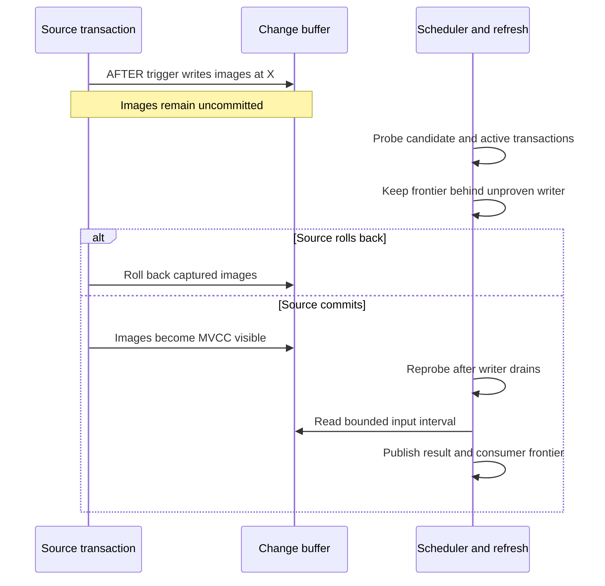
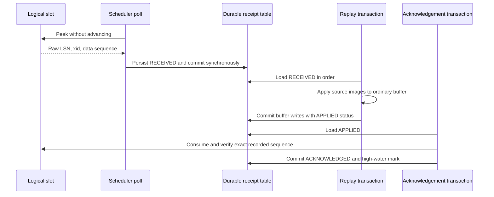

# Source capture, buffers, and safe frontiers

Capture and refresh publication are different responsibilities. Capture records changes that a later differential refresh can read; a frontier records the input boundary that a consumer has processed. Correctness requires both **transactional visibility** and **retention until every relevant consumer has passed a change**. An increasing WAL position alone proves neither.

The default is trigger capture. [ADR-001](../../plans/adrs/ADR-001.md#rationale) explains the rationale: source writes and buffer writes share a transaction, trigger errors fail synchronously, and ordinary capture does not need replication-slot management. Its older examples of WAL selection and simultaneous row/statement triggers are not the current interface. Use the authoritative [CDC configuration implementation](../../src/config/cdc.rs) and the builders described below instead.

For the other half of the contract—publishing storage changes, output deltas, and frontiers—see [refresh correctness](../workflows/refresh-correctness.md), [stream-table lifecycle](stream-table-lifecycle.md), and [differential maintenance](../concepts/differential-maintenance.md).

## Capture owners and buffer shape

| Source | Owner of capture | What becomes an input delta |
|---|---|---|
| Ordinary tracked table | AFTER triggers in the source transaction, or optional WAL receipt processing | Typed source row images in a shared base-source buffer |
| Upstream stream table | The upstream refresh executor | Output changes published to `changes_pgt_{pgt_id}` for downstream consumers |
| Foreign table or materialized view | Local polling and snapshot comparison | Differences between successive observed snapshots, not a remote transaction log |

Base buffers use `changes_<stable_name>` with an OID-name fallback for older tracking records. Stream-table buffers use a separate `changes_pgt_{pgt_id}` namespace. Both have flat, typed user columns rather than JSON or separate `new_*`/`old_*` column families. Metadata includes `change_id`, `lsn`, `action`, and the complete `BYTEA` identity `__pgt_row_id`; base buffers also carry `changed_cols`. Reserved user-column names are mapped with `cb_col_name`, for example `action` becomes `__usr_action`.

The ordinary row-image algebra is **D/I**: INSERT contributes an `I`, DELETE a `D`, and UPDATE an old-image `D` followed by a new-image `I`. A changed primary key must remove the old identity and add the new one. Keyless updates similarly emit both images. There are also control records: TRUNCATE capture writes `T`, while buffer registration installs a synthetic `S` sentinel at `0/0`. Do not interpret every buffer row as a user insertion or deletion. Keep the `change_id` sequence at its default **CACHE 1**: compaction depends on same-row modification ordering and must not inherit backend sequence-block inversions.

Sources: [buffer creation and registration](../../src/cdc/mod.rs#L307-L375), [typed base and stream buffers](../../src/cdc/mod.rs#L1064-L1273), [reserved columns](../../src/cdc/triggers.rs#L7-L35), [statement UPDATE builder](../../src/cdc/mod.rs#L2492-L2597).

### Default statement triggers, not dual capture

`pg_trickle.cdc_trigger_mode = 'statement'` is the default. The builder installs separate AFTER INSERT, UPDATE, and DELETE triggers, each `FOR EACH STATEMENT`, because PostgreSQL does not allow a combined multi-event transition-table trigger. They reference `NEW TABLE AS __pgt_new` and/or `OLD TABLE AS __pgt_old`, then bulk-insert the affected images with `INSERT … SELECT`. They are **not installed alongside an ordinary row trigger for duplicate capture**. Legacy `row` mode uses a combined `FOR EACH ROW` AFTER trigger instead. A separate AFTER TRUNCATE statement trigger exists in either mode. Changing the GUC affects new setups; `pgtrickle.rebuild_cdc_triggers()` migrates existing triggers.

The builders stamp DML with `pg_current_wal_insert_lsn()`, not the potentially lagging write position `pg_current_wal_lsn()`. Statement mode captures one statement LSN for its batch. Capture executes inside the writer's transaction: rollback removes the source changes and their buffer images together; another backend cannot consume uncommitted images. The wake notification is a scheduling hint, not a substitute for MVCC visibility or a durability boundary.

Sources: [trigger installation](../../src/cdc/mod.rs#L799-L971), [statement function bodies](../../src/cdc/mod.rs#L2427-L2629), [trigger-mode configuration](../../src/config/cdc.rs#L112-L125). See [security boundaries](security-boundaries.md) for the privilege context of extension-owned trigger functions and buffers.

### Stream-table and polling capture are separate owners

For stream-table-to-stream-table edges, the refresh executor captures its materialized output delta after MERGE or explicit DML when downstream consumers exist. It writes typed output images to the upstream stream buffer, rather than treating refresh writes as ordinary base-table CDC. In the normal split representation these are D/I rows; the compatibility `diff_output_format = 'merged'` branch can recombine matching pairs as `U`. A graph refresh publishes these deltas at its shared graph bound so later topological members can read them in the same pass. Publication and downstream frontier rules are covered in [refresh correctness](../workflows/refresh-correctness.md). See [output capture](../../src/refresh/codegen.rs#L1016-L1130).

Polling is opt-in through `pg_trickle.foreign_table_polling` or `pg_trickle.matview_polling`, both defaulting to false. Setup seeds a local persistent snapshot and registers consumers of a shared change buffer. A poll takes a source-scoped transaction advisory lock, materializes the source **once** into a temporary table, computes both directions of `EXCEPT ALL`, emits D/I images, and replaces the saved snapshot from that same materialization. This preserves duplicate multiplicities and avoids comparing two different source observations during one poll. Its LSN is local bookkeeping, not a remote commit LSN; intermediate states between polls are not a transaction history. Materialized-view polling detects externally refreshed contents using the same mechanism. See [polling implementation](../../src/cdc/polling.rs#L11-L215) and [materialized-view adapter](../../src/cdc/polling.rs#L218-L362).

## Visibility bounds: why a later LSN can still be unsafe

A trigger can write an image at LSN X while its transaction remains open. A scheduler that advances a consumer frontier beyond X while MVCC hides the image would exclude it from future `(previous, new]` scans even after commit. The captured LSN is an ordering coordinate, **not proof that all earlier changes are visible**.

*Transaction boundary: an AFTER trigger runs before commit, while a safe consumer boundary must account for still-invisible images.*

### Scheduled refreshes

`compute_safe_upper_bound` samples a materialized candidate write LSN and active transaction IDs from `pg_stat_activity` (`backend_xid` and `backend_xmin`), plus prepared transactions. The current writer-fence state machine is more precise than simply comparing two oldest-xmin values: a newly observed active transaction inherits the **previous candidate** as its fence; an already observed transaction retains its fence. The minimum live fence bounds advancement. An active transaction with no proven prior fence holds at the last safe position, or makes the bound unavailable if there is none. Safe state does not move backward.

Every coordinator mode performs this mandatory visibility proof. `frontier_holdback_mode = 'none'` **does not disable correctness probing**. `xmin` and invalid-LSN mode use the same mandatory path; `lsn:<N>` additionally caps the result at candidate minus N bytes. The ignored historical none-mode test still describes an unsafe bypass, but that commentary is not current behavior.

Probe failure is fail-closed. The ordinary coordinator path reuses a valid previous watermark or returns no bound; the byte-offset path returns no bound on failure. Neither advances to a raw write LSN as a fallback. The coordinator publishes per-database safe state for workers. See [writer-fence transition and probe](../../src/cdc/mod.rs#L3261-L3557) and [coordinator handling](../../src/scheduler/watermark.rs#L20-L155).

### Manual refreshes and per-source boundaries

Manual differential refresh is also bounded, but does not simply run the coordinator's probe. With an existing refresh/graph context it reuses that immutable bound. Otherwise it polls relevant polling sources, captures a candidate insert LSN **before** checking writer locks, and probes source relations, partition descendants, and the change-buffer schema for other writers. If writers exist, it uses `0/0` to hold progress. Without a supplied bound, REPEATABLE READ and SERIALIZABLE cannot establish this READ COMMITTED writer-lock proof and raise `SafeFrontierUnavailable`. The new frontier is merged with the previous frontier so a held bound does not replay already processed input. FULL baselines use protected source locking rather than this differential shortcut. See [manual differential bounds](../../src/api/refresh_ops.rs#L1017-L1082) and [baseline locks](../../src/cdc/mod.rs#L156-L245).

`get_slot_positions_at_bound` constructs actual per-source positions. Trigger sources use the highest visible buffer LSN capped by the immutable bound, or the bound when no positive-LSN rows exist. WAL sources require a nonzero committed `decoder_confirmed_lsn`; transitioning sources additionally cap that position by `cutover_lsn`. The legacy unbounded `get_slot_positions` API now returns an error. Do not replace these rules with a fresh WAL lookup halfway through refresh. See [bounded position construction](../../src/cdc/mod.rs#L2835-L2936).

## Shared retention: the slowest consumer owns the floor

One source buffer serves multiple stream tables. Cleanup uses the **minimum stored frontier across all consumers of that source**, not the frontier of the stream table that just refreshed. A fast consumer must leave rows needed by a slower one. Consumers without an established frontier are excluded from this minimum because they first require a FULL baseline; no usable threshold, or `0/0`, means no cleanup.

Base-source cleanup serializes the minimum-frontier calculation and deletion with a source advisory lock. Heap cleanup is bounded DELETE rather than destructive whole-buffer TRUNCATE; partitioned cleanup can detach consumed partitions. Stream-table buffers have their own minimum-downstream-frontier cleanup. This is also why compaction must preserve consumer boundaries, not merely collapse all pending history globally. See [base cleanup](../../src/refresh/codegen.rs#L270-L407), [stream-buffer cleanup](../../src/refresh/codegen.rs#L633-L715), and [shared-boundary tests](../../tests/e2e_shared_buffer_tests.rs#L14-L124).

## Durability is configured, not implied by the word buffer

`pg_trickle.change_buffer_durability` controls new base and stream buffers:

- **`logged` (default):** permanent WAL-logged tables, replicated to standbys, with normal PostgreSQL commit policy.
- **`unlogged`:** avoids buffer WAL traffic, but PostgreSQL truncates these tables on crash recovery and does not replicate their contents to standbys. This is recoverable through rebaselining, not unconditional preservation of pending deltas.
- **`sync`:** logged tables plus a registry-driven `synchronous_commit = on` policy in capture transactions. Trigger, polling, and stream-output writers consult that policy.

The deprecated `unlogged_buffers` setting is a compatibility input; changing configuration is not a retroactive persistence conversion of every existing buffer. Buffers are registered in `pgt_change_buffers` with durability and sentinel metadata. Validation detects missing or invalid required capture state; the scheduler marks a populated stream table for reinitialization and a FULL refresh instead of continuing differential maintenance over a silently empty buffer. Recovery depends on being allowed to establish that baseline; it is not a promise that the missing change history survives. See [durability configuration](../../src/config/cdc.rs#L152-L227), [sync policy](../../src/cdc/mod.rs#L269-L305), and [scheduler validation](../../src/scheduler/mod.rs#L4721-L4760). Operational repair belongs in [recovery and upgrades](../operations/recovery-and-upgrades.md).

## Optional WAL capture: receipts before acknowledgement

WAL capture is selected with `pg_trickle.cdc_mode` (`trigger`, `auto`, or `wal`), with effective requests reconciled per shared source. Eligible sources begin on triggers. Logical WAL and available replication slots are prerequisites; transition rechecks require a regular table, primary key, and `REPLICA IDENTITY FULL`. Ineligible sources stay on triggers. An explicit `wal` prerequisite check can report an error for non-logical `wal_level`, so do not assume every invalid explicit request silently succeeds through fallback. See [availability checks](../../src/cdc/rebuild.rs#L628-L655) and [eligibility rechecks](../../src/wal_decoder.rs#L2553-L2612).

The scheduler creates each slot in its own pristine transaction using PostgreSQL's replication API, then creates the publication and records `TRANSITIONING` with a cutover LSN. Trigger and WAL capture overlap until the exact handoff boundary is proven, rather than relying on a small lag heuristic. Completion serializes the source, takes a source lock, changes catalog mode to WAL, then removes triggers. See [scheduler setup phases](../../src/scheduler/scheduler_loop.rs#L1156-L1225), [transition setup](../../src/wal_decoder.rs#L2462-L2550), and [handoff proof and completion](../../src/wal_decoder.rs#L1763-L1934).

The executable receipt path uses **`test_decoding` and `pg_logical_slot_peek_changes()`**, not a pgoutput subscription or a separate decoder-worker handoff. Publication objects do not filter this plugin's output: canonical source names identify source rows, while unrelated messages are also retained to verify the full slot sequence.

*WAL boundaries: durable receipt persistence, buffer replay, and slot acknowledgement occur in separate transactions.*

Receipt persistence sets local `synchronous_commit = on`, stores raw messages in `pgt_wal_receipts`, and deduplicates on `(source_relid, lsn, data)`. Replay processes RECEIVED receipts in LSN/receipt order, writes only source changes to ordinary buffers, and changes status to APPLIED in that transaction. A later acknowledgement uses `pg_logical_slot_get_changes()` and compares the exact `(lsn, xid, data)` sequence before marking ACKNOWLEDGED and updating acknowledgement watermarks. If PostgreSQL advanced the slot before a worker died, confirmed slot progress lets acknowledgement finish without consuming it again. Thus `get_changes` still exists, but **only after durable receipt and replay**, not as the first capture boundary. See [receipt persistence](../../src/wal_decoder.rs#L536-L687), [replay](../../src/wal_decoder.rs#L850-L915), and [acknowledgement](../../src/wal_decoder.rs#L918-L1057).

Timeout, eligibility loss, repeated poll errors, and receipt replay/acknowledgement failures can return a source to trigger capture. Restoring triggers cannot recover undecoded WAL or unreplayed receipts by itself: fallback locks the source, ensures triggers, attempts slot/publication removal, resets capture state, and clears consumer frontiers while setting `needs_reinit`. Consumers must rebaseline. See [fallback implementation](../../src/wal_decoder.rs#L2002-L2096). Monitor retained-slot lag and transition health using [scheduling and observability](../operations/scheduling-and-observability.md).

## Focused correctness evidence

These tests define useful regression boundaries; their presence is not a claim that they were executed for this document.

- [Statement CDC tests](../../tests/e2e_stmt_cdc_tests.rs#L69-L511) inspect statement trigger metadata and transition-table names, assert bulk capture, D/I primary-key and keyless updates, and verify the legacy row-mode alternative.
- [Rollback through a two-level DAG](../../tests/e2e_dag_concurrent_tests.rs#L230-L262) refreshes after a source rollback and asserts that the phantom group is absent.
- [Long-transaction visibility](../../tests/e2e_long_txn_visibility_tests.rs#L96-L363) checks uncommitted invisibility followed by eventual capture for READ COMMITTED, REPEATABLE READ, and prepared transactions. The ignored none-mode narrative is historical, not an exemption from the current mandatory probe.
- [Shared-buffer tests](../../tests/e2e_shared_buffer_tests.rs#L14-L124) exercise base and stream compaction boundaries and keyless duplicates; [slowest-consumer coverage](../../tests/e2e_shared_buffer_tests.rs#L230-L288) checks different consumer progress.
- [Receipt interruption tests](../../tests/e2e_wal_receipt_recovery_tests.rs#L494-L579) terminate the backend before receipt persistence, before replay, before acknowledgement, and after slot advancement, then restart the same database and require exact convergence against a committed journal. They also verify acknowledgement and repeated-restart behavior. [Fallback and shared-source recovery cases](../../tests/e2e_wal_receipt_recovery_tests.rs#L877-L994) cover required rebaselining and slow-consumer retention.
