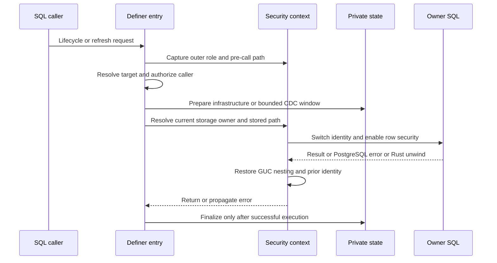

# Privilege, execution-context, and error boundaries

The critical separation is **authority to maintain extension infrastructure is not authority to run user SQL as the extension owner**. Lifecycle entrypoints and workers need private catalogs and CDC buffers; definition-derived SQL needs the stream storage owner's identity, stored name-resolution environment, and current PostgreSQL privileges. `SECURITY DEFINER` alone is therefore not the security model.

For deployment and disclosure guidance, see [SECURITY.md](../../SECURITY.md), the [security guide](../../docs/SECURITY_GUIDE.md), and [SQL API catalog](../../docs/SQL_API_CATALOG.md). The signature-by-signature authority contract lives in [sql_api_policy.json](../../scripts/sql_api_policy.json), not in a blanket rule that all `pgtrickle` functions are public or owner-only. Use current policy and implementation when older security prose differs—for example, current `write_and_refresh` is a definer entry with an explicit caller-context SQL phase.

## Authority is operation-specific

Function `EXECUTE` ACLs and runtime authorization are separate gates. Installation uses a deny-first policy with an explicit public read allowlist; do not replace exact grants with `GRANT EXECUTE ON ALL FUNCTIONS`.

| Boundary | Authority and execution model |
| --- | --- |
| Owner lifecycle | The policy classifies create, alter, drop, and related lifecycle functions as `definer_owner_checked`. Existing-target authorization uses the original caller, current storage relation, owner-equivalent role membership (`pg_has_role(..., 'USAGE')`), or superuser status. Creation separately checks target-schema `CREATE` and source `SELECT` plus schema `USAGE`. |
| Manual refresh | Owner-equivalent authority **or `MAINTAIN` on that exact storage relation** authorizes refresh. An unrelated `MAINTAIN` grant does not. The grantee does not become the query executor and need not independently have source `SELECT` for an ordinary delegated refresh. `MAINTAIN` does not authorize alter/drop lifecycle operations. |
| Diagnostics | Public-read, admin-global, internal, and trigger-entry functions retain their own policy classes. Read access to a diagnostic endpoint does not confer mutation authority. Owner-privilege preflight reports missing source `SELECT` and schema `USAGE` for the current storage owner. |
| External coordinator | Graph members use refresh authorization. Graph sources have a distinct check: owner-equivalent authority, or `SELECT` **and** `MAINTAIN` with schema `USAGE`. External orchestration is not permission to access private buffers; ordinary manual refresh rejects an `EXTERNAL` target and directs it to its coordinator. |

See [consumer contracts](../integrations/consumer-contracts.md) and [dbt materialization](../integrations/dbt-materialization.md) for integration-facing consequences.

## Entry, resolution, execution, restoration

*Privileged preparation and finalization surround, rather than replace, owner-context query execution.*

### Capture the original environment

Exported Rust definer entries pin `search_path` to `pgtrickle, pg_catalog, pg_temp`. That protects extension-internal resolution but is **not** the path on which a caller's unqualified names should be interpreted.

`capture_caller_context` captures `GetOuterUserId()` and the role name. For invoker entries it reads the active path; for definer entries it recovers the pre-function value from PostgreSQL's saved GUC stack. Missing or malformed saved state fails closed instead of silently persisting the pinned path. Standalone `$user` elements are expanded to the quoted caller role so subsequent execution under another identity does not reinterpret them.

`resolve_owned_stream_table_with_caller` resolves the target under that captured path, loads metadata, and checks ownership before private mutation. The ownership check looks up the live relation by schema/name rather than trusting a persisted OID that logical restore may have remapped. Refresh resolution follows the same caller-path principle but uses the narrower owner-or-`MAINTAIN` authorization. Creation's rewrite/analysis path is explicitly scoped by `with_invoker_search_path`; that helper changes **path**, not role, and restores the exact prior ambient path for nested calls.

### Run definitions as the current storage owner

`stream_execution_context` obtains the storage relation's current `pg_class.relowner` and `meta.defining_search_path`, the path captured when the definition was last established. `refresh::with_stream_owner` delegates to `with_stream_owner_context`; initialization also uses this wrapper for definition-derived work. An ownership transfer consequently changes the executing role, not the stored defining path.

The wrapper saves identity and security flags, creates a GUC nesting checkpoint, switches to the owner with `SECURITY_LOCAL_USERID_CHANGE`, and sets the stored path and `row_security = on`. The flag blocks another role transition while the temporary identity is active. It deliberately does not use `SECURITY_RESTRICTED_OPERATION`, because refresh may need temporary staging tables.

Cleanup is part of this boundary: `PgTryBuilder::finally` unwinds the GUC level with `AtEOXact_GUC(false, ...)` and restores the prior identity/security flags on success, PostgreSQL ERROR, or Rust unwind. Setup failures represented as `Result` also restore state before returning. The checkpoint unwinds **all** GUC changes made by owner SQL, including non-local `SET` or `set_config(..., false)`, not just the path and RLS setting. This prevents owner SQL from leaving a poisoned `pg_trickle.internal_refresh` value for later backend work.

`with_caller_context` supplies the analogous role/path/RLS scope for caller-controlled operations. In current `write_and_refresh`, arbitrary SQL executes inside that caller scope; the private refresh phase follows afterward. Ordinary `refresh_stream_table` turns `RefreshSkipped` into a notice, but `write_and_refresh` treats it as failure so the caller's write cannot commit as a false refresh success.

## Private state is not a source privilege shortcut

Application and stream-owner roles should not receive direct grants on private catalogs or `pgtrickle_changes` buffers. CDC trigger functions run as definers so source writers can capture changes without direct buffer privileges. Generated CDC functions pin a different internal path: `pgtrickle_changes, pgtrickle, pg_catalog, pg_temp`. Neither that path nor the exported API path includes `public`.

For differential execution, `DeltaStage::prepare` copies an immutable window `(previous_lsn, new_lsn]` from each private source buffer into a `pg_temp` table before changing identity. It grants the stream owner access to that staged window, not to the durable buffer. `stage_source` then runs `SELECT 1 FROM <source> LIMIT 0` as the stream owner: buffered data does not bypass a newly revoked source privilege. RLS-enabled staging has a temporary DELETE grant for visibility filtering, revoked afterward. Temporary stages use `ON COMMIT DROP`; failed revoked-source refresh tests assert unchanged storage and no leaked stages.

Do not overlook parse analysis: even `CREATE TEMP TABLE ... AS <definition-derived SQL> WITH NO DATA` resolves functions, operators, casts, and relations. `prepare_owner_temp_table` documents that such creation must itself be wrapped in owner context, not merely the later data-producing statement.

### RLS is revalidated, not frozen at creation

`row_security = on` means PostgreSQL applies the executing owner's normal semantics; it does not remove superuser or `BYPASSRLS` exemptions. FULL refresh reevaluates the defining query under that current owner context.

Incremental maintenance has a stronger admission constraint. A current-state visibility probe cannot reconstruct whether an old UPDATE/DELETE image was visible before a policy-relevant change. DIFFERENTIAL therefore permits RLS sources only for a superuser or `BYPASSRLS` owner; IMMEDIATE rejects RLS-enabled sources. AUTO can fall back to FULL during admission. Stored incremental queries are checked again before manual execution, and the scheduler performs semantic revalidation too. Enabling RLS or revoking `BYPASSRLS` after creation must not silently continue applying previously admitted deltas.

Stream-table reader policy is separate from source policy: storage is an ordinary PostgreSQL table and can have its own RLS policies. See [refresh correctness](../workflows/refresh-correctness.md) for correctness beyond this identity boundary.

## SQL construction and internal write guards

Use [sql_builder.rs](../../src/sql_builder.rs): `ident` doubles identifier quotes, `qualified` quotes schema and object separately, and SPI `$N` parameters carry values. `literal` is for fixed generated/DDL fragments, **not** a substitute for parameterizing user values. Quoting prevents syntax injection; it does not establish ownership or execution authority.

Storage DML guards reject INSERT/UPDATE/DELETE and TRUNCATE unless `pg_trickle.internal_refresh` is exactly `true`. Initialization and refresh set that marker transaction-locally. The row guard returns OLD for DELETE and NEW for other row operations so authorized deletes are not accidentally canceled. Treat this as a managed-write invariant, not a standalone privilege credential: it does not replace relation ACLs, owner authorization, or scoped execution. Unlike privileged CDC functions, the generated storage guard shown in `install_dml_guard_trigger` is not declared `SECURITY DEFINER`; do not infer one universal generated-function path from the CDC rule.

## Error and worker boundaries

Internal helpers propagate `Result<T, PgTrickleError>` with contextual variants rather than raising SQL errors at every layer. At exported boundaries, `raise_error_with_context` adds targeted SQLSTATE, DETAIL, and HINT fields for selected variants (for example unsupported operators, cycles, schema changes, and query parse failures); other variants fall back to `pgrx::error!`. Do not assume every `SpiError(String)` preserves the original SQLSTATE: `SpiErrorCode` is a distinct representation, while scheduler panic extraction/classification can preserve SQLSTATE and prefers it to localized message text.

Workers retain privileged infrastructure authority but use the same owner execution wrapper for definition-derived SQL, resuming their prior identity before private finalization. Privileged manual bookkeeping can set `row_security = off`; its owner-execution scope explicitly turns it back on. This is not a reason to disable RLS around the user's query.

PostgreSQL ERROR is not an ordinary Rust return. The scheduled refresh boundary combines an internal subtransaction, a **local** `pg_guard_ffi_boundary`, and `catch_unwind`. The local handler intercepts a PostgreSQL longjmp before it skips the Rust catch frames. On failure the code restores `PG_exception_stack`, rolls back partial refresh effects, and only then records/classifies failure in the valid outer transaction. `SubTransaction` restores `CurrentMemoryContext` and `CurrentResourceOwner` on commit/rollback, with rollback-on-drop as a fallback.

Optional diagnostics may intentionally degrade to missing data: the schema-version audit helper, for example, returns `None` when it cannot collect information. This is **not** a durable-write policy. Required buffer checks, initialization operations, and refresh execution must propagate errors; failed publication of data/frontiers must not become apparent success. See [recovery and upgrades](../operations/recovery-and-upgrades.md).

### Review obligations and focused assertions

Changes crossing unsafe/FFI boundaries need explicit review of backend-thread assumptions, pointer lifetime, PostgreSQL memory-context ownership, GUC-stack layout/type checks, exception-stack restoration, and cleanup ordering. A Rust RAII guard or `catch_unwind` alone is not proof against a PostgreSQL longjmp. Keep tests for both PostgreSQL ERROR and pure Rust panic paths.

The most useful security assertions are:

- **No private grants required:** [ownership tests](../../tests/e2e_ownership_tests.rs) cover non-superuser creation/lifecycle and private dependencies, source access denial, and mixed-owner cascade rejection without mutation.
- **Delegation is exact and does not change identity:** [MAINTAIN tests](../../tests/e2e_v1150_maintain_grantee_refresh_tests.rs) cover unrelated/revoked grants, owner execution, owner RLS, captured path, and lifecycle denial.
- **Source revocation and policy changes fail safely:** [owner-execution tests](../../tests/e2e_v0878_security_tests.rs) cover private-buffer probes and revoked-source rollback; [RLS tests](../../tests/e2e_rls_tests.rs) cover incremental admission, revoked bypass authority, and trigger hardening.
- **Hostile path and failure restoration are separate checks:** verify pinned `proconfig` on privileged functions even when caller schemas shadow names, while legitimate definition names resolve through the captured path. [Security-context tests](../../src/api/security_context.rs) check pre-definer path recovery, nested contexts, PostgreSQL ERROR, Rust panic, and arbitrary GUC restoration. [Unsafe-boundary tests](../../tests/e2e_unsafe_boundary_tests.rs) inspect before/after state inside an instrumented definer frame so PostgreSQL's eventual function-return cleanup cannot mask a missing inner restoration.

Run `python3 scripts/check_privilege_boundaries.py` and `bash scripts/check_security_definer.sh` with the relevant backend/E2E tests. The former checks exported definer paths and source-local direct caller SQL, dynamic SQL assembly, and external calls, and invokes SQL API policy coverage. These are focused lint checks, not a transitive proof of safety through every helper. See [change verification](../testing/change-verification.md) and [stream-table lifecycle](stream-table-lifecycle.md) when extending the boundary.
