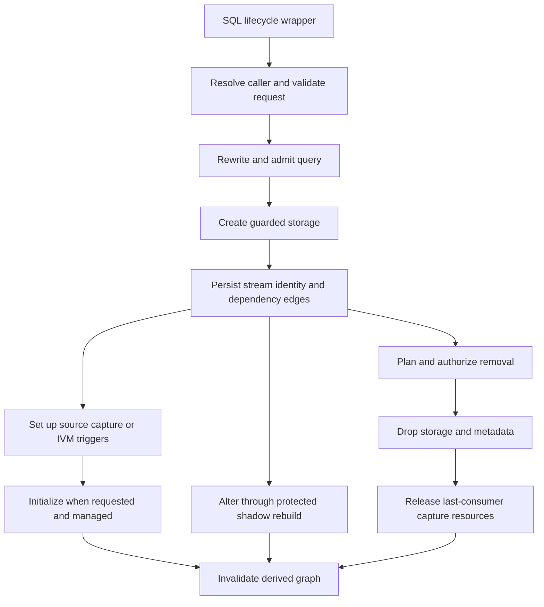

# Stream table lifecycle and dependency ownership

A stream table is more than its visible PostgreSQL relation. Its lifecycle coordinates a storage OID, a durable stream identity (`pgt_id`), a defining query and execution context, dependency edges, capture infrastructure, and refresh progress. The catalog is the durable relationship owner; `StDag` and refresh-template caches are derived views that lifecycle operations invalidate.

Use the [SQL reference](../../docs/SQL_REFERENCE.md) for callable parameters and the [architecture reference](../../docs/ARCHITECTURE.md) for the wider runtime. This page follows ownership and ordering rather than duplicating signatures or catalog inventories.

## Entry points and transaction boundary

Public `#[pg_extern]` wrappers translate SQL arguments into shared implementations and turn returned errors into PostgreSQL errors. `create_stream_table` delegates to `create_stream_table_impl`; alteration and removal similarly reach `alter_stream_table_impl` and `drop_stream_table_impl`. The create wrapper is `SECURITY DEFINER` with a pinned search path, but that is not permission to interpret user SQL as the extension owner: the implementation captures the original caller's search path, resolves the output name there, checks schema CREATE access, and validates source access. Output-table ownership is transferred to the caller. Alter requires ownership or superuser authority. See [security boundaries](security-boundaries.md).

The durable DDL and catalog mutations run in PostgreSQL's surrounding transaction. A later failure must not expose half a new definition or partially replaced storage. Query alteration explicitly relies on rollback to restore old auxiliary state. This is **not** a promise that every side effect is transactional: shared-memory invalidation is a rebuild hint, cache prewarming is best-effort, and several cleanup paths emit warnings rather than aborting. Legacy replication-slot cleanup also deserves separate treatment from transactional table DDL.

*Lifecycle control flow: storage and durable dependencies are established before capture and initial population; replacement and removal invalidate derived graph state. Based on [create](../../src/api/alter.rs#L1735-L1907), [initialization](../../src/api/alter.rs#L1982-L2054), and [drop](../../src/api/alter.rs#L3028-L3187).*

## Creation: admission before materialization

The shared create path performs these responsibilities in order:

1. **Normalize controls.** Resolve refresh admission, orchestration, schedule, diamond policy, and CDC request. Reject invalid combinations before building storage.
2. **Prepare the query in caller context.** `run_query_rewrite_pipeline` and `validate_and_parse_query` share the captured caller search path. The validated result supplies output columns, parsed maintenance structure, source OIDs and source kinds, and auxiliary-state requirements. Source-access validation follows.
3. **Check identity and graph constraints.** Reject duplicate stream names, invalid partition controls, and disallowed dependency cycles.
4. **Create storage.** `setup_storage_table` creates the relation, indexes, and DML guard, including maintenance columns required by the admitted query.
5. **Persist the contract.** `insert_catalog_and_deps` inserts the stream metadata and per-source dependency edges. It records column usage and, for table-like sources, column snapshots/fingerprints used by DDL tracking. Rewritten definitions can retain the original SQL; inlined views also receive soft dependencies so their later DDL is not invisible.
6. **Install maintenance infrastructure, then populate.** Set up capture/IVM, transfer output ownership, optionally call `initialize_st`, and finally signal DAG invalidation. Differential cache prewarming is an optimization, not a condition of successful creation.

Evidence: [validation and storage ordering](../../src/api/alter.rs#L1530-L1758), [catalog relationships](../../src/api/mod.rs#L1899-L1975), [view tracking and completion](../../src/api/alter.rs#L1959-L2054).

### Keep the state axes separate

| Axis | Meaning |
|---|---|
| Requested refresh admission | `AUTO` requests DIFFERENTIAL admission with FULL fallback. The original request is retained as `requested_refresh_mode`. |
| Persisted refresh mode | `RefreshMode` has FULL, DIFFERENTIAL, and IMMEDIATE—not an AUTO execution variant. |
| Observed execution | `effective_refresh_mode` records the mode observed for a materialization; it need not be read as the original request. |
| Population and progress | `is_populated`, `frontier`, and `needs_reinit` describe whether materialized state exists and whether it is usable for incremental work. |
| Operational status | ACTIVE, SUSPENDED, and ERROR gate refresh independently of the requested mode. |
| Orchestration ownership | MANAGED versus EXTERNAL determines who may coordinate refresh, not how deltas are computed. |

AUTO initially maps to Differential and can become Full during validation; create warns on that fallback. Initialization records an effective mode separately. Do not infer that an unpopulated table is suspended, or that a differential table's next execution must be differential: manual dispatch chooses full materialization when there is no frontier and reinitialization when required. [Mode model](../../src/dag.rs#L242-L291), [admission](../../src/api/alter.rs#L1648-L1685), [requested mode persistence](../../src/api/alter.rs#L1888-L1892), [initial execution reporting](../../src/api/alter.rs#L2014-L2029), [refresh dispatch](../../src/api/refresh_ops.rs#L336-L355).

EXTERNAL creation deliberately leaves storage unpopulated even when `initialize` was requested. EXTERNAL cannot use IMMEDIATE, whose maintenance belongs to PostgreSQL triggers. Ordinary manual refresh rejects EXTERNAL tables; query, refresh-mode, partition, and freshness alterations also require MANAGED ownership. This boundary matters for [dbt materialization](../integrations/dbt-materialization.md) and other coordinators. [Create ownership rules](../../src/api/alter.rs#L1491-L1529), [refresh guard](../../src/api/refresh_ops.rs#L196-L225), [alter guard](../../src/api/alter.rs#L2230-L2245).

## Dependency ownership and graph boundaries

A dependency edge connects a consuming `pgt_id` to a source relation OID and source kind. It is not equivalent to a private trigger owned by that consumer:

- Scheduled consumers of ordinary tables share source-level CDC tracking. The first consumer creates a typed buffer and trigger; later consumers join `tracked_by_pgt_ids`. Adding a consumer can widen the union of referenced columns, rebuild capture SQL, and invalidate existing consumers' MERGE templates.
- Foreign tables and materialized views use polling setup. Scheduled stream-table sources acquire an upstream stream change buffer for downstream delta consumption.
- IMMEDIATE consumers install transition-table IVM triggers instead of deferred CDC. A source shared with scheduled consumers still needs deferred CDC maintenance.

These distinctions explain why deleting a consumer must consult surviving dependency edges rather than blindly removing its sources' infrastructure. See [change capture](change-capture.md). [Capture setup](../../src/api/mod.rs#L1980-L2014), [shared CDC](../../src/api/helpers.rs#L240-L333), [mixed-consumer DDL handling](../../src/hooks.rs#L977-L992).

Despite the `StDag` name, the admitted dependency structure is not always a simple DAG:

- **Diamonds:** create defaults to atomic consistency and the fastest schedule policy. `slowest` requires atomic consistency; opting out at a detected convergence point produces a notice about inconsistent cross-branch reads.
- **Supported cycles:** cycles are rejected unless `pg_trickle.allow_circular` is enabled. Cycle validation requires DIFFERENTIAL members and verifiable monotone queries. ALTER replaces the existing node's incoming edges before cycle detection and checks the proposed query, not the old stored query. SCC IDs are persisted for cyclic members.
- **Mixed scheduled/IMMEDIATE propagation:** the execution graph builds cyclic-SCC units and consistency groups, then conservatively folds downstream IMMEDIATE closures into execution units. Treating each stream as an independently scheduled node loses this boundary.

[Diamond admission](../../src/api/alter.rs#L1537-L1579), [diamond notice and SCC assignment](../../src/api/alter.rs#L1909-L1962), [cycle validation](../../src/api/helpers.rs#L2489-L2617), [execution-unit construction](../../src/dag.rs#L1741-L1879). Scheduling details belong in [scheduling and observability](../operations/scheduling-and-observability.md).

## Refresh and mutation of an existing stream

### Refresh preserves a coherent progress boundary

The ordinary manual-refresh path resolves and authorizes the target, refuses replicas and CDC hold mode, and rejects SUSPENDED or ERROR status. It acquires a transaction-scoped advisory lock and a catalog row lock (`FOR UPDATE SKIP LOCKED`) so manual and scheduler work cannot independently race. Metadata is reloaded after locking: otherwise a stale frontier could replay already-consumed changes. The capture-readiness gate runs after the stream lock.

`execute_manual_refresh` enables the internal DML-guard bypass and dispatches full, differential, or reinitialization work using current state. Definition-derived SQL runs through stream-owner execution rather than treating privileged bookkeeping as authority for user SQL. See [refresh correctness](../workflows/refresh-correctness.md) and [differential maintenance](../concepts/differential-maintenance.md). [Refresh locking](../../src/api/refresh_ops.rs#L171-L293), [execution context and dispatch](../../src/api/refresh_ops.rs#L304-L355).

### Configuration changes are not query-state reuse

`create_stream_table_if_not_exists` leaves an existing definition unchanged. `create_or_replace_stream_table` creates when missing, compares rewritten SQL with whitespace normalization when present, and delegates changed query/configuration to ALTER; an identical definition is a no-op. It is not implemented as unconditional drop-and-create. [Idempotent create](../../src/api/create.rs#L148-L165), [replacement routing](../../src/api/create.rs#L604-L725).

Query alteration has a stronger boundary than a schedule update. It locks the target, recovers or rolls back shadow-build state, validates the proposed query, and classifies whether state reuse is proven. A compatible result returns without rebuilding; rejected changes fail before replacement. Otherwise it:

- locks old and new triggerable sources in stable OID order and suspends the stream;
- invalidates templates and removes query-derived window/set-operation state;
- creates isolated shadow storage while preserving the original owner;
- points metadata at the shadow with a fresh frontier and unpopulated state, replaces dependencies, and reconciles removed, added, and retained source infrastructure;
- fully populates the shadow, atomically swaps it into place, clears shadow/error state, and reactivates the stream.

A semantic query change does **not** reuse the old frontier merely because visible column names and types match. Retained CDC sources may need wider buffers, and retained IMMEDIATE triggers must be retargeted to the new storage OID. Publication bindings can prohibit storage replacement. [Classification and locking](../../src/api/alter.rs#L785-L925), [shadow contract](../../src/api/alter.rs#L942-L1053), [capture reconciliation and cutover](../../src/api/alter.rs#L1090-L1216).

### Source DDL is another lifecycle entry point

DDL hooks consume saved dependencies and column snapshots. They fail closed if dependency relevance cannot be inspected, distinguish deferred CDC from IMMEDIATE consumers, and can invalidate contracts, mark reinitialization, or suspend a stream rather than silently trusting old SQL. Column-affecting DDL is blocked by default through `pg_trickle.block_source_ddl`; turning it off is an explicit maintenance decision, not a guarantee that every schema change is incrementally compatible. [DDL classification and guard](../../src/hooks.rs#L955-L1092).

## Removal and last-consumer teardown

Drop first builds and authorizes the complete downstream plan under the caller's captured search path. Without `cascade`, extra downstream targets cause rejection; publication bindings are prevalidated before execution. Per-stream execution serializes lifecycle work with advisory and catalog locks, handles publication bindings and IVM triggers, flushes deferred cleanup references, drops auxiliary state and storage, and deletes the catalog row (whose deletion cascades to dependencies).

Only then can source-level teardown safely decide what remains owned. Base-table cleanup checks surviving dependencies, excluding the current consumer during ALTER when its old edge still exists. The last consumer releases CDC triggers, buffers, and tracking metadata; legacy WAL/transitioning state additionally requires slot/publication cleanup. Stream-to-stream buffers are similarly removed when unused. Dropping a consumer does not mean dropping its base source. Removal ends with graph/template invalidation and, when necessary, SCC recomputation. Some stream-buffer cleanup failures are warnings, so successful logical removal is not an unconditional assertion that every best-effort resource cleanup succeeded. [Drop planning and execution](../../src/api/alter.rs#L3028-L3187), [last-consumer predicate](../../src/api/helpers.rs#L338-L401).

## Focused regression checks

These tests are useful change-review anchors; their presence is not a claim that they were run for this page.

| Concern | Focused test and assertion |
|---|---|
| Idempotent replacement | `test_cor_noop_when_identical` checks unchanged row count and data timestamp for an identical definition. [Test](../../tests/e2e_create_or_replace_tests.rs#L63-L104) |
| Query rebuild success | `test_alter_query_oid_changes_for_semantic_same_schema_change` checks that a semantic change replaces the storage OID even with the same output schema. [Test](../../tests/e2e_alter_query_tests.rs#L663-L692) |
| Failure preserves old state | `test_alter_query_invalid_query` verifies ACTIVE status, population, and original rows after rejection; `test_alter_query_cycle_detection` verifies rejection preserves the original stream. [Tests](../../tests/e2e_alter_query_tests.rs#L554-L617) |
| Shared capture ownership | `test_drop_removes_cdc_trigger` and `test_drop_preserves_trigger_for_other_st` distinguish last-consumer cleanup from shared-source retention. [Tests](../../tests/e2e_drop_tests.rs#L99-L166) |
| DDL guard regression | `test_ddl_hooks_dependency_lookup_timeout_fail_closed` exercises blocked DDL when dependency inspection times out; `test_block_source_ddl_guc_prevents_alter` covers the explicit schema-change guard. [Timeout test](../../tests/e2e_ddl_event_tests.rs#L150-L192), [guard test](../../tests/e2e_ddl_event_tests.rs#L810-L857) |
