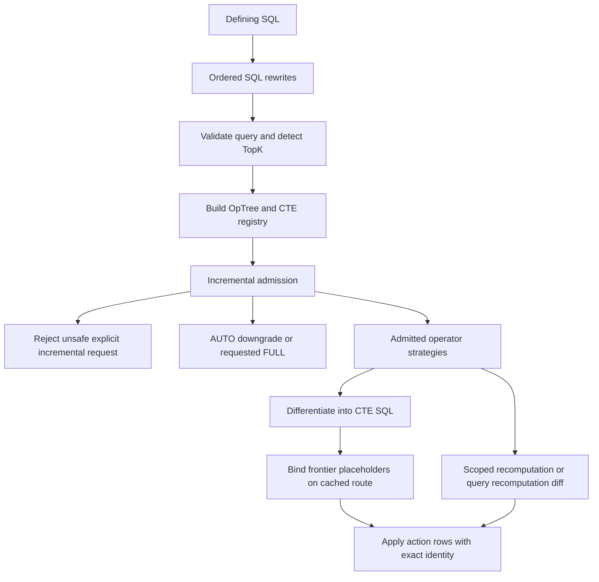

# Query differentiation, identity, and SQL admission

The correctness target is a **multiset**, not a set of distinct rows: after applying a refresh, the stream table must contain the same values with the same multiplicities as evaluating its defining query. Query acceptance, incremental admission, delta generation, and physical application are separate decisions. A parser branch or a `diff_*` implementation is not, by itself, evidence that a query shape is admitted for incremental execution.

Use the [operator reference](../../docs/DVM_OPERATORS.md), [SQL reference](../../docs/SQL_REFERENCE.md), and [limitations reference](../../docs/LIMITATIONS.md) for support matrices and API details. This page describes the invariants behind those surfaces, not a replacement support matrix.

## From SQL to an applied delta


*The main non-TopK route separates SQL validation and admission from delta construction and application; TopK is detected before ordinary LIMIT rejection and uses a specialized route.*

### Rewrite order is part of the contract

`run_query_rewrite_pipeline` runs these passes in order:

1. Inline views, so constructs inside view definitions can be rewritten too.
2. Lift nested window expressions, recording whether this happened.
3. Rewrite `DISTINCT ON` to a `ROW_NUMBER()` window.
4. Expand `GROUPING SETS` / `CUBE` / `ROLLUP` into `UNION ALL` branches.
5. Rewrite scalar subqueries in `WHERE`, then correlated scalar subqueries in `SELECT`.
6. Apply De Morgan normalization and SubLinks-in-OR rewriting, stopping at stability or three iterations.
7. Rewrite `ROWS FROM()`.

Do not reorder these as independent text cleanups: earlier passes expose structures to later passes, and rewrite metadata affects mode handling. For example, nested-window lifting has an explicit AUTO-to-FULL handling path rather than implying that the rewritten tree can generate safe delta SQL. [Source](../../src/api/mod.rs#L682-L735)

`validate_and_parse_query` validates the defining query and output schema, detects TopK **before** rejecting other LIMIT/OFFSET forms, checks unsupported constructs and source restrictions, and constructs an `OpTree` plus `CteRegistry` for incremental non-TopK queries. The registry allows shared CTE bodies to have a reusable delta rather than being independently differentiated for every reference. [Validation](../../src/api/mod.rs#L1013-L1269), [parser entrypoint](../../src/dvm/parser/sublinks/mod.rs#L1423-L1430)

### Four outcomes that must not be conflated

- **Unsupported SQL rejection:** validation or parsing can fail. AUTO is not a blanket promise to rescue every SQL error; for example, ordinary LIMIT/OFFSET rejection is outside the unsupported-construct downgrade branch.
- **AUTO downgrade:** `IncrementalAdmission::FullOnly` resolves to FULL for AUTO, but yields an `UnsupportedOperator` error for an explicit incremental request. Admission examines the main tree and registered CTE bodies, including refresh-dependent STABLE/VOLATILE expressions.
- **Recomputation-diff:** an operator can reevaluate a partition, affected group, or full query and compare it with old state, still producing action rows. This is different from an admission-time FULL downgrade.
- **Differential execution:** operators derive changes from child deltas and the snapshots/state their individual rules require. Physical application may still select different merge strategies.

The current gate marks `INTERSECT` and `EXCEPT` as unproven for incremental execution even though operator delta generators exist. Their private branch-count state is populated during FULL refresh; its existence must not be used to bypass admission. [Admission](../../src/dvm/parser/validation.rs#L34-L142), [private set-operation state](../../src/setop_state.rs#L1-L28)

Also distinguish planning diagnostics from execution changes: `planner::build_delta_plan` can report a cheaper candidate inner-join order as `validation_status: "shadow"`, with `selected: false`; the chosen plan retains the original order. It is not a production join-tree reorderer. [Source](../../src/dvm/planner.rs#L527-L643)

### Delta generation and binding

`generate_delta_query_impl` reparses the effective defining query, collects source OIDs from both tree and registry, performs optional vector-aggregate reclassification, checks IVM support and `RowIdSchema`, then creates `DiffContext`. That context receives target storage metadata, CDC column/key information, source-buffer routing, and, on the staged route, owner-visible temporary CDC relations. `differentiate_with_columns` returns SQL, output columns, deduplication status, and the key-change signal. These flags influence application correctness, not just performance. [Source](../../src/dvm/mod.rs#L701-L821)

`DiffContext` dispatches recursively to operator-specific generators and assembles `WITH ... SELECT ...` SQL. Its result contains `__pgt_row_id`, `__pgt_action`, user columns, and any required auxiliary columns. It checks that typed schema names agree with emitted column names and bounds differentiation depth and CTE growth. Intermediate subtrees must not accidentally use the final stream table as their own aggregate state. [Source](../../src/dvm/diff.rs#L918-L1008)

On the cached route, generation uses LSN placeholder templates. Binding supplies previous/new frontier values for base OIDs and `pgt_` stream-source entries; unresolved internal placeholders are errors, not SQL to execute. Scan windows use `lsn > previous AND lsn <= new`. IMMEDIATE differentiation instead has a transition-table delta source, without the deferred change-buffer interval. See [change capture](../architecture/change-capture.md) for the upstream frontier boundary. [Binding](../../src/dvm/mod.rs#L274-L398), [cache contract](../../src/dvm/mod.rs#L845-L855), [scan boundary](../../src/dvm/operators/scan.rs#L211-L212), [interval](../../src/dvm/operators/scan.rs#L332-L332), [delta sources](../../src/dvm/diff.rs#L21-L43)

## Signed multiplicity and duplicate rows

Conceptually, a delta is a finite map from rows to signed integer weights: insertion contributes `+1`, deletion `-1`, and an update removes an old image and adds a new image. SQL commonly represents these as repeated `I`/`D` action rows, then computes net counts. Cancellation is a **bag** operation: replacing `UNION ALL` or `EXCEPT ALL` with distinct variants can destroy legitimate duplicate occurrences.

Identity does not imply uniqueness. Identical keyless payloads can share `__pgt_row_id` while representing multiple stored occurrences. A delete of one of three identical rows must leave two, not remove every matching identity. The counted-delete template counts deletion actions per complete identity and deletes only that many numbered storage occurrences. Its statement-local `ctid` selects physical victims; it is **not** a persistent logical identity. [Counted application](../../src/refresh/codegen.rs#L2023-L2063)

Treat NULL separately at each semantic boundary:

- SQL predicates retain PostgreSQL three-valued logic; NULL join keys do not become equal simply because identity encoding represents NULL.
- Group/state matching uses NULL-safe comparisons such as `IS NOT DISTINCT FROM`.
- An aggregate's row count is not its non-NULL argument count. Auxiliary sums/counts and nonnull counters must preserve empty/all-NULL behavior, rather than replacing every NULL aggregate with zero.

The aggregate merge updates AVG sum/count auxiliaries independently and carries old values for NULL-safe change detection. Project-level `COALESCE(SUM(...), default)` is tracked explicitly; it is not interchangeable with bare `SUM`. [Group matching](../../src/dvm/operators/aggregate.rs#L127-L153), [auxiliary merge](../../src/dvm/operators/aggregate.rs#L2131-L2210), [COALESCE metadata](../../src/dvm/diff.rs#L168-L181)

## Snapshot rules: old and current are not interchangeable

Let `L0`, `R0` be pre-change bags and `L1`, `R1` post-change bags. Where an exact `L0` is available, the inner-join rule is:

```text
ΔJ = (ΔL ⋈ R1) + (L0 ⋈ ΔR)
```

This includes the simultaneous-change cross term exactly once. The current implementation explicitly **disables** splitting left-delete actions against `R0` when this exact `L0` rule is used: adding that split would introduce another cross-term error. Do not copy the older formula at the top of `join.rs` or in an ADR as a universal implementation rule. [Executable selection](../../src/dvm/operators/join.rs#L335-L450)

Pre-change reconstruction removes inserted occurrences from current data and restores deleted occurrences, conceptually `current EXCEPT ALL inserts UNION ALL deletes`. `SnapshotPlan` distinguishes exact per-leaf reconstruction, exact combined reconstruction, post-change-with-correction, and unsupported snapshot forms. Pure multi-leaf join trees can reconstruct leaves and rejoin them; joins under SemiJoin/AntiJoin context deliberately switch away from that plan because it interacts with the ancestor's own old-state correction. Set-operation, window, recursive, and some lateral subtrees are not supported by this generic snapshot mechanism. That is a snapshot limitation, not automatically rejection of the whole query. [Planner](../../src/dvm/snapshot.rs#L26-L78), [tree classification](../../src/dvm/snapshot.rs#L126-L180), [join usage](../../src/dvm/operators/join.rs#L341-L403)

### Neighboring operators have different responsibilities

**Outer joins.** A LEFT JOIN must maintain both matched pairs and the NULL-padded row when match count crosses zero: gaining a first match removes the padded row; losing the last match restores it. FULL JOIN handles both sides. Action-sensitive old/current checks and cross-term corrections are part of these generators; they cannot be replaced by an inner join followed by NULL filling. [LEFT JOIN](../../src/dvm/operators/outer_join.rs#L1-L36), [FULL JOIN](../../src/dvm/operators/full_join.rs#L3-L49)

**Aggregates.** A group has signed child-count changes and aggregate-specific state. AVG uses maintained sum/count auxiliaries; non-invertible or intermediate forms can rescan affected groups, including old-state reconstruction where needed. HAVING needs special care for groups absent from storage because they were previously below the threshold. An intermediate aggregate cannot assume its output is the final stored row layout. [Intermediate strategies](../../src/dvm/operators/aggregate.rs#L660-L751), [merge auxiliaries](../../src/dvm/operators/aggregate.rs#L2161-L2179), [HAVING context](../../src/dvm/diff.rs#L145-L166)

**Set operations.** Correct branch multiplicities include values that are currently invisible—for example, a value suppressed by EXCEPT can become visible after a right-side deletion. Private `__pgt_setop_state_<pgt_id>` relations keep branch counts out of user-visible output and are populated transactionally with FULL refresh. Current admission still fails closed for incremental INTERSECT/EXCEPT. Do not infer current execution from their counter-based generator comments. [State ownership](../../src/setop_state.rs#L1-L28)

**Windows.** The production plan is partition recomputation: find changed partition keys, rebuild affected input, reevaluate windows, then emit changed rows where exact child identity permits, otherwise replace affected partitions. The window planner currently sets `runtime_enabled = false` even for eligible state-backed candidates. `window_state.rs` owns private candidate lifecycle states (`BUILDING`, `READY`, `STALE`, `OVER_BUDGET`); READY alone is not permission to route production refreshes through that candidate. [Generator](../../src/dvm/operators/window.rs#L1-L15), [strategy selection](../../src/dvm/parser/window_plan.rs#L297-L338), [state statuses](../../src/window_state.rs#L18-L43)

**Recursion.** The recursive generator rejects multiple self-references, selects recomputation-diff if stored output columns do not match the recursive relation or the recursive term is non-monotone, and otherwise chooses semi-naive insertion propagation or DRed when delete/update images are present. DRed includes rederivation from current data to preserve alternative derivations. These are generator rules, still subordinate to query admission. [Selection](../../src/dvm/operators/recursive_cte.rs#L95-L199)

## Typed identity is complete bytes, not a hash

Despite legacy helper names such as `build_hash_expr_for_domain`, current generated identities use `encode_row_id_v3`. V3 encodes a versioned, domain-separated tuple with ordered type tags, NULL/value markers, and framing. V2 remains a byte-for-byte immutable wire version; V3 corrects bpchar canonicalization rather than silently changing V2. Preserve full-refresh/initial-population identity agreement with delta identity when adding an operator or encoder. [SQL identity construction](../../src/dvm/operators/scan.rs#L915-L927), [versions and domains](../../src/dvm/row_id_v2.rs#L12-L49), [tuple framing](../../src/dvm/row_id_v2.rs#L682-L760)

`row_probe_v1` is only a bounded lookup accelerator: identities up to 128 bytes are returned unchanged; longer identities use a 128-byte prefix plus a seeded XXH3-128 digest. Matching must also compare complete `__pgt_row_id` bytes. A probe collision must never become row equality. Identity metadata/type/collation failures are explicit errors; do not add text-rendering fallback encodings to make an unsupported type appear accepted. [Probe](../../src/dvm/row_id_v2.rs#L1518-L1529), [exact apply predicate](../../src/refresh/codegen.rs#L2226-L2232), [encoder errors](../../src/dvm/row_id_v2.rs#L146-L170)

`RowIdSchema` provides a separate structural guard: keyed scans, all-column identities, group keys, composed join identities, and pass-through/derived operators must form compatible pipelines. It does not make a keyless bag unique and does not replace byte equality. [Schema inference](../../src/dvm/row_id.rs#L107-L200)

## Repair is not a substitute for differentiation

[ADR-003](../../plans/adrs/ADR-003.md) explains the historical phantom-row motivation, but its formulas and cleanup guarantees should not be treated as the current execution specification. The inspected deferred apply path gates reconciliation on join presence, no recursive CTE, non-deduplicated delta, no stream partition key, and no active user triggers. Cleanup compares stored versus recomputed **multisets**, repairing surplus and missing rows; it does not establish that every row has multiplicity one. When repair changes rows beyond the original bounded downstream delta, consumers are marked for reinitialization. [Current caller](../../src/refresh/merge/mod.rs#L3453-L3506), [reconciliation](../../src/refresh/phd1.rs#L17-L63)

For lifecycle consequences see [stream-table lifecycle](../architecture/stream-table-lifecycle.md), [consumer contracts](../integrations/consumer-contracts.md), and [refresh correctness](../workflows/refresh-correctness.md).

## Safe extension and verification checklist

When changing a rewrite or operator:

1. Check both parsing and admission, including registered CTE bodies. Do not promote a dormant generator by accident.
2. State exactly which snapshots and target/private state the rule reads, including simultaneous changes on both sides.
3. Preserve typed column order, NULL behavior, complete identity domains, and duplicate counts across initial population, FULL, and differential routes.
4. Treat `is_deduplicated`, auxiliary columns, and intermediate context as correctness contracts.
5. Add direct and composed tests, and verify that the test actually exercises the intended physical route rather than merely producing correct results through fallback or repair.

Focused sources to extend:

- [Equivalence tests](../../tests/e2e_diff_full_equivalence_tests.rs#L26-L49): the mode helper accepts DIFFERENTIAL, APPEND_ONLY, and TOP_K. Inner/outer joins, aggregates, windows, HAVING, CTEs, and simultaneous EXISTS/NOT EXISTS changes have targeted cases. The helper checks a mode label, not proof that every internal operator avoided recomputation or repair.
- [Duplicate-row tests](../../tests/e2e_keyless_duplicate_tests.rs#L18-L121): exact duplicates, delete-one, update-one, and aggregate multiplicities. Their SQL uses `ctid` to mutate one source occurrence; the old comment calling this logical identity is not the current identity contract.
- [Composition matrix](../../tests/e2e_dvm_composition_tests.rs): checks published mandatory coverage, generated schemas/shapes, and end-to-end composed queries, including nested join subtrees and wide-source/narrow-projection cases.

These test files were inspected, not run for this page. See [change verification](../testing/change-verification.md) for the broader verification workflow.
