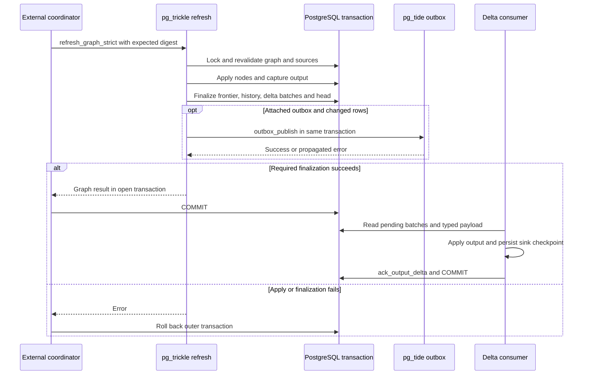

# External orchestration and durable consumer contracts

pg_trickle exposes three different downstream boundaries. **Delta V1** is a durable, typed output log with extension-owned consumer cursors. A **PostgreSQL publication** exposes stream-table storage through logical replication. An attached **pg_tide outbox** receives refresh summaries, not row payloads. These are not interchangeable delivery protocols, and their acknowledgements and recovery mechanisms belong to different owners.

For signatures and supported SQL forms, use the [SQL reference](../../docs/SQL_REFERENCE.md) and [extension contract index](../../docs/integrations/extension-contracts.md). This page describes the checked-in extension and [public-SQL reference clients](../../tests/conformance/reference_clients.rs), not implementations of external orchestration products.

## Who owns refresh execution?

`orchestration_mode` is durable ownership, separate from the full/differential refresh algorithm:

- **`MANAGED`** leaves refresh scheduling with pg_trickle.
- **`EXTERNAL`** removes the table from scheduled refresh execution. Creation leaves it unpopulated until its coordinator refreshes it, even if initialization was requested. Ordinary manual refresh is rejected; the coordinator uses `refresh_graph_strict`.
- `EXTERNAL` cannot be combined with `IMMEDIATE`, whose maintenance is trigger-owned. Refresh-affecting alterations of an external table are rejected until ownership returns to `MANAGED`.

`set_orchestration_mode` checks stream-table ownership, locks and re-reads its catalog row, validates the combination, and signals a DAG rebuild when ownership changes. `stream_table_spec` exposes operational metadata including orchestration mode and contract generation; it is not a substitute for the canonical contract used to authorize a compiled graph plan.

See [stream-table lifecycle](../architecture/stream-table-lifecycle.md), [dbt materialization](dbt-materialization.md), and the [ownership implementation](../../src/api/integration.rs#L51-L124).

## Compile against a contract, then validate at execution

Start by discovering `integration_capabilities()`: Graph and Delta capabilities have independent major/minor versions. Do not substitute the extension package version for protocol negotiation.

`stream_table_contract` describes a stream table's identity, query digests, output schema, defining search path, owner and RLS flags, refresh/orchestration modes, row-identity and planner/rewrite versions, dependencies, functions, and database-instance identity. Source metadata includes capture mode, schema information, stable name, and placement. The digest is **SHA-256 over a versioned typed canonical encoding**, not a hash of JSON text. Arrays preserve order; sets and JSON object entries are byte-sorted. Clients should use the returned digest rather than reserialize the diagnostic JSON.

`graph_contract(roots)` computes the complete upstream stream-table closure. It rejects empty or duplicate roots, managed members, unsupported durable sources, and cycles. The topological order is deterministic, with sorted ready members. Its digest binds the database instance, roots, member digests and generations, edges, execution order, and sources. A changed contract is a recompile/revalidation boundary, not permission to run an old plan anyway.

`refresh_graph_strict` then:

1. Checks capture readiness, `full_policy` (`ALLOW` or `ERROR`), and the expected graph digest.
2. Authorizes every member using the original outer caller, acquires advisory transaction locks and catalog row locks in sorted relation order, and rebuilds the contract under those locks.
3. Rejects a digest change during lock acquisition, locks source relations/capture boundaries, and establishes a shared safe WAL bound.
4. Refreshes nodes in topological order with a shared graph refresh ID and source-boundary digest. `ERROR` prohibits whole-query full fallback; `ALLOW` permits it.
5. Returns node results and boundary metadata in the caller's transaction. A returned row is not a commit acknowledgement.

Graph authorization is not supplied by a digest. Members use refresh authorization; ordinary table sources require owner-equivalent authority or delegated `SELECT` and `MAINTAIN` with schema `USAGE`. Temporary relations and unsupported dependency kinds are rejected. The security-definer entrypoints explicitly check the outer caller rather than treating extension-owner execution as permission. See [security boundaries](../architecture/security-boundaries.md) and the bounded [graph implementation](../../src/api/integration.rs#L606-L1124).

## What commits together?

The common refresh finalizer runs **inside the caller's existing transaction**. It requires proven downstream CDC completion, persists frontier/metadata/history, publishes the output-delta batch, and, for non-empty refreshes with an attached outbox, calls `tide.outbox_publish`. Required durable failures propagate: they must not turn an applied-but-unpublished refresh into a reported success.

*Publication and acknowledgement sequence: refresh publication is transactional, while a downstream sink checkpoint is a separate consumer responsibility unless deliberately co-transactional.*

This boundary also matters for logical replication: stream-storage DML belongs to the refresh transaction, so rolled-back output is not committed publication output. Publication setup is a separate DDL operation, not an extra network delivery step in `finalize_success`. A pg_tide publish or binding-validation error aborts refresh finalization, rolling back its output, frontier, and Delta publication together. Repair the failed dependency and retry from durable state; do not acknowledge an event or graph result that never committed. See [refresh correctness](../workflows/refresh-correctness.md) and [the finalizer](../../src/refresh/mod.rs#L927-L1143).

## Delta V1: bootstrap and batch consumption

### Establish a baseline first

`register_output_delta_consumer` requires an external stream table, capture readiness, owner-equivalent stream authority, a matching expected stream-contract digest, and a known row-identity version. It returns the consumer ID and typed relation, `pgtrickle_changes.output_delta_<pgt_id>`. Consumer operations require the recorded consumer owner or a superuser. The payload relation revokes public access and grants `SELECT` to the registering owner.

The default registration state is `RESNAPSHOT_REQUIRED` with reason `INITIAL_BASELINE_REQUIRED`. `CURRENT` is allowed only when the catalog says the stream table is pristine/unpopulated; it is not a way to skip an existing baseline. Re-registering the same stream/owner/name with the same contract returns its existing cursor and state, rather than resetting progress.

For a baseline, use one transaction to:

1. Call `begin_output_delta_resnapshot` from `RESNAPSHOT_REQUIRED` or `INVALIDATED`.
2. Read the stream table and establish the downstream baseline while the stream lock fences refresh. Keep baseline data and the returned contract/head together.
3. Call `ack_output_delta_resnapshot` with the returned token, then commit.

The token binds consumer, log head, database instance, contract digest, and row-identity version. Acknowledgement rejects stale or replayed tokens, advances the cursor to the fenced head, updates expected identity/contract metadata, activates the consumer, and deletes the token. Do not commit between beginning the baseline and reading it merely because the API returned a token; the locking fence is transaction-scoped. See [baseline implementation](../../src/api/output_delta.rs#L1213-L1383).

### Read modes, not just rows

There is one shared durable log per stream table and a separate cursor per consumer. Capture starts at the internal stream CDC buffer's current change ID. Finalization copies captured D/I rows into the typed public relation with `batch_token`, zero-based `ordinal`, `DELETE`/`INSERT` action, binary `row_identity`, and output columns. Batch metadata carries producing refresh ID, optional graph refresh ID, contract/identity versions, counts, and source-boundary digest.

- **`EXACT`** requires a differential refresh with complete capture, a recorded capture start, and supported D/I actions. A proven empty apply can produce an exact zero-row batch.
- **`FULL_INVALIDATION`** has no row payload. Full/reinitializing execution, missing capture evidence, or incomplete exact evidence must not be interpreted as an empty exact diff. The consumer must resynchronize from current output.

`output_delta_batches` returns pending metadata in token order and checks completeness. Read payload by the returned batch token and `ORDER BY ordinal`; an empty payload alone does not identify the batch's meaning. The public log is populated from internal `changes_pgt_*` capture, but **it is not that buffer**. Internal buffers serve stream-to-stream propagation and frontier cleanup. External consumers must use their returned public relation and durable cursor APIs, not depend on internal buffer retention. See [batch construction and pruning](../../src/api/output_delta.rs#L495-L691).

### Acknowledgement, checkpoints, and retention

`ack_output_delta` requires `ACTIVE`, validates the consumer, and accepts a token between the current acknowledgement and log head. It advances the durable cursor transactionally. `APPLIED` cannot cover a `FULL_INVALIDATION`; that range requires `RESYNCHRONIZED` after the consumer has actually reconciled its output.

The extension does not atomically commit an arbitrary remote sink. Persist a sink checkpoint with the applied output and design replay/deduplication around the durable consumer position before acknowledging. A crash after sink work but before acknowledgement may require replay; a successful SQL call in an uncommitted transaction does not advance durable progress. The reference suite explicitly checks acknowledgement rollback.

Pruning deletes payload and batch metadata through the minimum acknowledged token among `ACTIVE` and `PAUSED` consumers. A paused consumer can therefore hold retention back. Invalidated and resnapshot-required consumers do not pin that minimum; if no eligible minimum exists, this pruning function does nothing. Do not assume time-based Delta retention from the pg_tide outbox's `retention_hours` setting.

## Invalidation is a recovery state, not a partial success

Validation under stream/log/consumer locks checks database-instance identity, current and expected contracts, row-identity version, contiguous batch coverage, metadata, payload relation/schema, counts, actions, and ordinals. A detected inconsistency persists `INVALIDATED` with a reason such as `DATABASE_INSTANCE_CHANGED`, `CONTRACT_MISMATCH`, `ROW_IDENTITY_VERSION_MISMATCH`, `DELTA_GAP`, or `PAYLOAD_INCONSISTENT`.

Use `validate_output_delta_consumer` and status inspection to diagnose this state. An invalidated consumer must not consume a partial pending range; normal acknowledgement returns `INVALIDATED` rather than advancing it. `request_output_delta_resnapshot` moves active/paused consumers to `RESNAPSHOT_REQUIRED` with `ADMIN_REQUESTED`, preserves the log and cursor, and discards outstanding resnapshot tokens. Existing integrity-invalidated states remain invalidated until a new baseline is acknowledged.

Rebaseline through the fenced protocol after repairing the cause. Clone/adoption recovery also requires a fresh baseline across database identity changes; a token from the former identity is not a portable checkpoint. See [recovery and upgrades](../operations/recovery-and-upgrades.md) and [consumer validation](../../src/api/output_delta.rs#L268-L435).

## Other output integrations and optional distributed capture

**Logical publications.** `stream_table_to_publication` creates a standard publication for stream storage. Public DDL runs with caller authority: stream ownership does not grant database `CREATE` or publication privileges. The private binding is transactional with DDL and validates live publication OID/name/owner, stream relation, relation set, and scope. Renaming, replacing, or transferring the publication is not silently accepted as the original binding. Subscriber slots, catch-up, and replication acknowledgements are PostgreSQL concerns, not Delta cursors. Follow the [publication guide](../../docs/PUBLICATIONS.md), including detach/recreate guidance around dump/restore.

**pg_tide outbox.** pg_trickle owns attachment and refresh-summary publication, not pg_tide's consumer groups, leases, polling, relays, or retention implementation. The envelope contains counts and source metadata, not changed rows; embedding attachment adds routing metadata. Compatibility/provenance checks protect the binding, including replacement of an outbox under the same name. See the [outbox guide](../../docs/OUTBOX.md) and [publication call](../../src/api/outbox.rs#L486-L533). Do not infer a remote delivery guarantee from the local transaction.

**Optional Citus coordination.** The extension supplies placement detection, stable source-object naming, worker capture-slot/topology coordination, and coordination locks. Stable source names derive from the schema-qualified name with a fixed-seed hash rather than a node-local OID; OIDs still remain in catalog/frontier compatibility paths. These names are not the canonical contract digest, a Delta token, or a distributed sink checkpoint. Compatibility helpers check worker extension versions and logical WAL configuration. Keep Citus deployment assumptions separate from Graph V1's advertised local trigger/WAL boundary; these helpers do not establish an arbitrary cross-system atomicity guarantee. Use the [Citus integration guide](../../docs/integrations/citus.md) for deployment and failure operations rather than deriving them from this page.

## Focused verification

The following checked-in tests bound the intended contracts; this page does not assert they were executed during documentation work:

- [Graph/Delta reference conformance](../../tests/e2e_v104_conformance_tests.rs#L325-L565): coordinator commit, delegated source authority, baseline activation, typed exact payload, graph ID correlation, and acknowledgement.
- [Recovery conformance](../../tests/e2e_v108_conformance_tests.rs#L206-L548): non-pristine bootstrap, acknowledgement rollback, invalidation disposition, persisted gap/payload/contract/identity failures, and resnapshot recovery.
- [Publication crash recovery](../../tests/e2e_publication_crash_recovery_tests.rs#L541-L902): initial sync/setup failures, subscriber restart, publisher crash, retained-slot catch-up, and negative controls.
- [Outbox integration tests](../../tests/e2e_outbox_tests.rs#L55-L468): missing/incompatible pg_tide, caller-context denial, attachment provenance, publishing on refresh, and rejection of a recreated outbox.
- [Citus chaos tests](../../tests/e2e_citus_chaos_tests.rs): worker/coordinator death, leases, rebalance, stale slots, and network recovery. These distributed scenarios are not a blanket delivery guarantee.

For choosing and running verification, see [change verification](../testing/change-verification.md).
