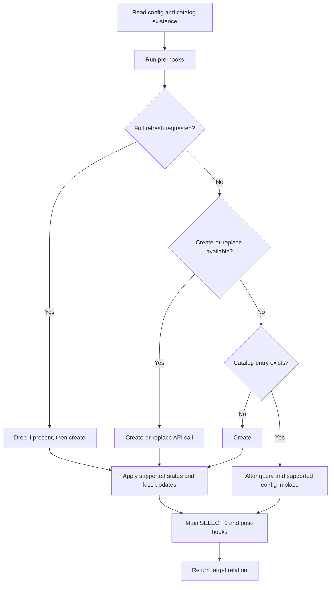

# dbt materialization lifecycle and transaction safety

## Ownership and entrypoint

`dbt-pgtrickle` is a **Jinja SQL package using stock `dbt-postgres`**, not a Python adapter. dbt compiles model SQL and supplies configuration, relations, hooks, and statement execution. The package's PostgreSQL-only `stream_table` materialization turns that compiled query into calls to the extension's SQL API; PostgreSQL and pg_trickle own the actual stream-table resources and refresh machinery.

Start with the [package README](../../dbt-pgtrickle/README.md) for installation and configuration, the [user integration guide](../../docs/integrations/dbt.md) for usage, and [consumer contracts](consumer-contracts.md) for the broader integration boundary. This page explains implementation and safe changes rather than reproducing their configuration tables. The package manifest currently permits dbt `>=1.9.0,<2.0.0`; the local test runner defaults to dbt Core and dbt-postgres 1.10.

The entrypoint is [`stream_table.sql`](../../dbt-pgtrickle/macros/materializations/stream_table.sql), registered with `adapter='postgres'`. It derives `target_relation` from `this.incorporate(type='table')`, then forms the API target as `stream_table_schema.stream_table_name`, defaulting to that relation's schema and identifier. Current executable defaults include `schedule='1m'`, `refresh_mode='AUTO'`, and `initialize=true`—older defaults in prose are not authoritative.

## Decision path during a model run


*Decision flow for the current materialization; status handling on a first create-or-replace has an important qualification described below.*

1. **Check the extension catalog, not just dbt's cache.** `pgtrickle_stream_table_exists()` queries `pgtrickle.pgt_stream_tables` by schema and name. This accommodates creation or deletion outside dbt. The helper splits a two-part name, otherwise defaults to `target.schema`; it is not a general parser for quoted identifiers containing dots. Existence is read **before** pre-hooks, so hooks that change the same stream table can invalidate that snapshot.
2. **Run pre-hooks, then honor `should_full_refresh()`.** If a catalog entry exists and full refresh is requested, the materialization drops it and marks it absent. Full refresh bypasses create-or-replace even if supported and calls ordinary create. An absent table is simply created.
3. **Probe capability, not a version string.** `pgtrickle_has_create_or_replace()` looks for a function named `create_or_replace_stream_table` in the `pgtrickle` namespace via `pg_proc`/`pg_namespace`, caching the boolean in the available dbt context. It does not check the complete SQL signature or gate every newer option by version.
4. **Prefer the idempotent API on ordinary runs.** With the capability present and no full refresh, the materialization calls `pgtrickle_create_or_replace_stream_table()`. The extension creates an absent table; for an existing table it rewrites and whitespace-normalizes the query, compares configuration, and either returns unchanged or delegates changes to alter. This is server-owned idempotency, not a Jinja drop/recreate algorithm.
5. **Otherwise create or alter using catalog metadata.** The fallback fetches current information and supplies the compiled query to `pgtrickle_alter_stream_table()`. A changed query is passed as `query => ...` for **in-place alteration**. Do not restore the older guidance that query changes require drop/recreate: current executable macros do not do that. The fallback label does not establish compatibility of all current arguments with an arbitrarily old extension.

### Status, fuses, and change detection

Create and create-or-replace wrappers do not accept status/fuse parameters, so the materialization applies them through a follow-up metadata read and alter. On ordinary create and full-refresh recreation, any explicitly configured status or fuse option triggers that follow-up. On the fast path, **status alone triggers it only if the table existed before the call**; a first create-or-replace with only `status='PAUSED'` does not apply status. A configured fuse parameter also enters this follow-up, including on first creation.

The alter wrapper compares query, schedule, refresh mode, requested CDC mode, status, and fuse values with catalog state. Unchanged values are emitted as SQL `NULL` to mean “keep current”; absent metadata makes the wrapper do nothing. However, `append_only`, `max_differential_joins`, and `max_delta_fraction` are treated as needing alter whenever non-null, not compared with catalog values. Since the materialization passes `append_only=false` by default, do not assume every unchanged fallback run avoids an SQL alter call.

### Reporting to dbt

After lifecycle calls, the materialization executes a named `main` statement containing `SELECT 1`, runs post-hooks, and returns `{'relations': [target_relation]}`. The returned relation remains derived from `this`; it is not rebuilt from `stream_table_name` or `stream_table_schema` overrides. Verify downstream `ref()` and test targeting when introducing naming overrides. There is no explicit `adapter.cache_new()` call in the current materialization, despite older development guidance recommending one.

See [stream-table lifecycle](../architecture/stream-table-lifecycle.md) for the resources behind the SQL calls.

## Transaction boundary: persistent mutations, not one atomic model

Every mutating wrapper in [`macros/adapters`](../../dbt-pgtrickle/macros/adapters/)—create, create-or-replace, alter, drop, and refresh—uses this pattern:

```jinja

  BEGIN;
  SELECT pgtrickle.drop_stream_table({{ dbt.string_literal(name) }});
  COMMIT;

```

**Do not replace these blocks with `run_query()`.** `run_query()` uses dbt's connection; it is not a separate DDL connection or an independent commit boundary. The explicit SQL `COMMIT` is what preserves successful lifecycle mutations rather than leaving them subject to later dbt transaction cleanup. `auto_begin=False` prevents the statement block from asking dbt to begin another transaction automatically. The comment beside the materialization's `main` no-op claiming DDL runs through `run_query()` on a separate connection is stale.

These commits also limit rollback expectations: a full refresh has a committed drop followed by a separately committed create. If create fails, the old stream table is not restored by rolling back the model. Likewise, a later status update or post-hook failure cannot undo an already committed create-or-replace. Hooks and lifecycle calls must not be advertised as one atomic transaction. When investigating an apparently successful run, inspect the catalog and data from another session rather than trusting only dbt's `OK` output.

## Safe macro changes

Follow [package development guidance](../../dbt-pgtrickle/AGENTS.md), but resolve its older lifecycle descriptions against current executable macros.

- **Quote string values with `dbt.string_literal()`.** Names passed as text API arguments, schedules, modes, status, and optional string settings use it. Do not splice raw user strings into SQL. This is SQL value quoting, not identifier quoting or authorization; database permissions remain a separate [security boundary](../architecture/security-boundaries.md).
- **Audit the defining-query exception.** Current create, create-or-replace, and alter wrappers embed compiled SQL inside fixed `$pgtrickle$` delimiters. That is not `dbt.string_literal()` escaping: a query containing the same delimiter needs special attention. Numeric/boolean options are also rendered directly and should retain their intended types. Do not generalize this implementation into a claim that arbitrary strings are universally escaped.
- **Guard catalog `run_query()` calls with `if execute`.** Parse-time helpers must return harmless defaults without querying the database. Existence/capability helpers return `false`; metadata returns `none`. Check both the result and row count before indexing `.rows`; a missing table is `none`, not an empty dictionary. Some operations currently iterate `results.rows` directly, so this is a change/review obligation, not a guarantee that every macro already follows the ideal pattern.
- **Keep mutations behind focused wrappers and preserve explicit commits.** Use `pgtrickle_` naming for helper/adapter macros, PostgreSQL-only materialization registration, dbt `log()` for messages, and `exceptions.raise_compiler_error()` for fatal validation failures. Do not add Python adapter code or `adapter.dispatch()` to this package.
- **Trace an option end to end.** Check config extraction, both creation wrappers, fallback alter/change detection, metadata fields, SQL API argument order/defaults, and first-create versus existing-table behavior. Creation-only settings cannot be assumed to become mutable because a Jinja argument exists. Preserve pre/post hooks and relation reporting, and update tests and the changelog.

## Operations and health checks

Operations reuse the same mutation wrappers. `pgtrickle_refresh` accepts an explicit qualified name or qualifies it using its schema argument/`target.schema`. `refresh_all_stream_tables` intersects graph-managed models with catalog dependency ordering, refreshing upstream before downstream; its dependency query selects active tables, but its final existence-based fallback can also attempt managed tables absent from that ordering. Do not read it as an unconditional guarantee to skip every paused table.

`drop_all_stream_tables` restricts deletion to `stream_table` models in the dbt graph and checks catalog existence. `drop_all_stream_tables_force` instead enumerates the entire catalog, including non-dbt tables. The latter is deliberately destructive, not a cleanup synonym.

Health has separate surfaces:

- `pgtrickle_check_cdc_health` calls `pgtrickle.check_cdc_health()` and raises a compiler error if a returned source is unhealthy.
- `pgtrickle_stream_table_status` reads the monitoring view and operational settings. Classification precedence is drained, paused (including CDC pause), erroring, stale, then healthy; missing/parse-time results produce `not_found`. It also exposes the force-full flag.
- The generic `stream_table_healthy` test is **direct SQL against `pg_stat_stream_tables`**, not a call to that helper despite its comment. It returns failing rows for pause, consecutive errors, or staleness. A missing catalog row returns no failing row, so pair it with existence assertions; it does not replicate the helper's drained/CDC-pause classification.

## Verification when changing macros

Run the integration suite after **every macro change**:

```bash
just test-dbt-fast   # reuse an existing pg_trickle_e2e:latest image
just test-dbt        # rebuild the extension image from source
```

Use the fast route for Jinja-only changes against a known-current image. Rebuild when extension/Rust/SQL API changes must be exercised, or when the image is missing or stale. Both recipes invoke the [integration runner](../../dbt-pgtrickle/integration_tests/scripts/run_dbt_tests.sh), which starts a fresh container (default port `15432`), prepares `.venv-dbt`, installs dependencies, seeds data, and exercises create, schedule alteration, repeated runs, full-refresh recreation, refresh operations, freshness checking, and graph-scoped drop. The container is removed by default; use the runner's `--keep-container` option for focused manual work rather than assuming `just test-dbt-fast` leaves it running.

Also run `dbt compile` for Jinja resolution and target the changed behavior: query alteration without recreation, capability fallback, first-create status/fuse application, hooks, name overrides, and cross-session persistence after commits. The existing runner explicitly tests a schedule change from `1m` to `3m`; it does not itself demonstrate every query/status/failure branch. Its `assert_compat_alter_applied` assertion belongs only after the alteration and is excluded from initial and post-full-refresh tests. Existing integration assertions cover catalog presence, aggregate results, active status, errors, refresh history, fuse settings, and partition keys.

For broader validation policy see [change verification](../testing/change-verification.md). **No tests were run for this documentation task**; the commands above are required validation routes, not reported passing results.
