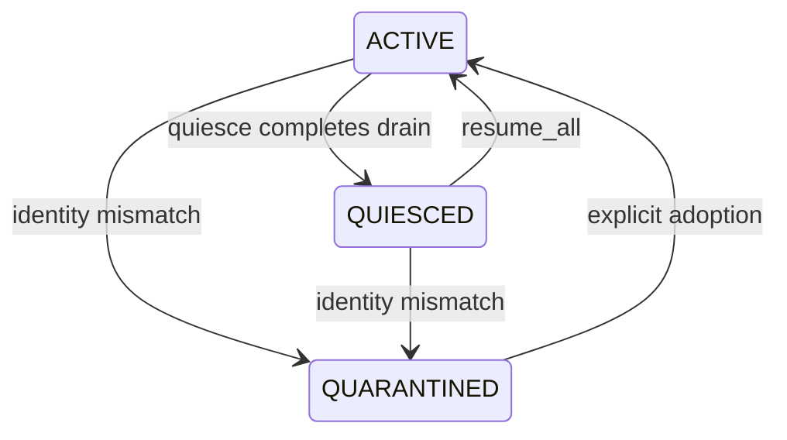

# Recovery, backup, and upgrade boundaries

Durable state is more than a materialized result. A usable stream table also needs the right source relations, capture infrastructure, and a frontier whose history is still recoverable. A copied catalog is therefore not permission to resume incremental processing. Recovery separates **ownership of capture**, **validity of each stream table**, and **external consumer continuity**.

For procedures, use [Backup and Restore](../../docs/BACKUP_AND_RESTORE.md), [Upgrading](../../docs/UPGRADING.md), [HA and Replication](../../docs/HA_AND_REPLICATION.md), and the [drain runbook](../../docs/RUNBOOK_DRAIN.md). This page explains the boundaries those procedures must preserve, rather than duplicating their command catalogs.

## Which boundary was crossed?

| Event | What can remain useful | What must not be assumed |
|---|---|---|
| Crash restart of the same database | Committed PostgreSQL state, matching capture identity, and surviving logged buffers can support continuation. | An interrupted refresh completed, or an empty buffer proves there were no changes. UNLOGGED loss requires rebuilding, not advancing the old frontier. |
| Logical `pg_dump` / `pg_restore` | Source data, derived storage, durable configuration, and registered dependency/CDC rows are copied under the extension's dump policy. Saved definitions can recreate the DAG. | Restored OIDs identify the original sources, stable CDC names remap them, slots were backed up, or old frontiers are reusable. |
| Physical restore, clone, or failover | Physical state may preserve relation OIDs, storage, catalogs, buffers, and slot state. | A physical copy is automatically an independent capture owner, or required WAL/slots survived the particular restore/promotion method. Validate before accepting writes. |
| Stream-table snapshot restore | One registered stream's derived rows and recorded frontier can be restored after provenance and layout checks. | A snapshot backs up sources, CDC history, or external consumer checkpoints. It does not establish that changes since its frontier are still retained. |
| Extension SQL upgrade | Existing storage and pending deltas may remain usable across compatible changes. | New library code alone updates SQL objects or makes old row-identity/state formats valid. Migrations can deliberately force reinitialization. |

The physical-copy distinction matters: the capture check compares **database OID and PostgreSQL system identifier**, not a host identifier or timeline. A clone retaining both values is not distinguishable by that check alone. Operational isolation and slot/WAL validation remain necessary; this is not split-brain fencing. See [change capture](../architecture/change-capture.md) for the capture path and [refresh correctness](../workflows/refresh-correctness.md) for frontier semantics.

## Capture ownership is a fail-closed gate

`pgt_capture_instance` stores a singleton `instance_id`, expected database OID and system identifier, lifecycle state, and observed mismatch information. `ensure_capture_instance()` initializes an absent owner, compares it with the current database, and returns a ready, quiesced, or quarantined gate. A mismatch enters `QUARANTINED`; stream tables not already suspended are suspended with `needs_reinit` and `CDC_CLONE_DETECTED`. Quarantine stays closed even if the observed identity later matches again.

The scheduler consults `capture_gate_allows_work()`. Manual refresh, repair, and several integration entrypoints use `assert_capture_ready()`, which rejects both quiesced and quarantined instances. This is a dispatch/API gate, not a reason to continue application writes during a restore or upgrade.

*Capture-instance lifecycle. Adoption reopens the instance gate but leaves every stream table suspended pending protected reinitialization.*

`quiesce(timeout_s)` signals a shared-memory drain and persists `QUIESCED` only once that drain completes. It returns `false` when signaling is unavailable or the wait times out; callers must check the result. `pause_all()` is an alias using 60 seconds. `resume_all()` clears the drain and records `ACTIVE`, but refuses quarantine. Neither operation is a substitute for validating restored state.

`recover_capture_instance()` explicitly adopts the current database with a new instance ID, clears quarantine observations, and resets **all** stream tables to suspended, unpopulated, `needs_reinit`, and `frontier = NULL`. It does **not** remap source OIDs. The API has an elevated security boundary; review grants and caller behavior with [security boundaries](../architecture/security-boundaries.md).

Adoption also rotates output-delta log identity and invalidates every non-dropped output-delta consumer with `DATABASE_INSTANCE_CHANGED`. Old batches and cursors are retained, but outstanding resnapshot records are deleted: retained checkpoint bytes do not authorize continuation in the new database instance. Consumers need a new baseline through the [consumer contract](../integrations/consumer-contracts.md).

## Validation classifies loss; repair establishes a new baseline

`capture_instance_status()` reports stored identity/state; it is not itself a reconciliation operation. `validate_recovery()` runs the identity gate and inspects dependency existence, enabled CDC triggers for trigger/transitioning sources, buffer registrations and physical relations, required buffer columns, WAL slots for WAL/transitioning dependencies, slot `wal_status = 'lost'`, and persisted source LSNs against `pg_current_wal_lsn()`.

Important outcomes are:

- **Operator intervention:** clone detection; the failure taxonomy also reserves `CDC_REPAIR_INTERRUPTED` for interrupted repair. The latter is a classification in current code, not evidence of a separate durable repair journal or automatic interrupted-repair detector.
- **Reinitialization required:** missing triggers, missing or malformed buffers, missing slots, unavailable WAL, or a frontier ahead of the recoverable WAL position. A future frontier suspends its stream with `RECOVERY_FRONTIER_UNPROVEN`; it is not silently clamped to the current LSN.
- **Missing source:** the dependency check reports `BLOCKER` and suspends affected streams with `CDC_SOURCE_MISSING`.

Read individual `checks`, not just the report's top-level status. In current code the top-level recovery aggregation prioritizes quarantine, then `REINITIALIZATION_REQUIRED`, otherwise `SAFE`; a dependency-only `BLOCKER` does not enter that aggregation. Likewise, `SAFE` is evidence about these implemented checks, not a proof of every source-to-frontier history relationship or consumer contract.

`repair_stream_table()` first requires a ready instance and caller ownership. It acquires source relation locks before the stream advisory and catalog-row locks, verifies publication binding, resets private window/set-operation state and the frontier, marks storage unpopulated for full rebuilding, and rebuilds missing capture buffers/triggers. It clears error/fuse state and makes the stream eligible for refresh. IMMEDIATE storage is rebuilt under source locks; deferred streams remain marked for rebuilding on a subsequent refresh. Publication contracts can forbid implicit storage replacement.

`reinitialize_stream_table()` reuses repair and the protected `ALTER QUERY` path, allowing a source schema change to rebuild the output schema. Neither API guesses which newly assigned OID corresponds to an old dependency. Missing sources require correcting the query or recreating the stream-table DAG. After repair, verify the actual result against its defining query, not merely the returned action summary.

### Interruption and buffer durability

Scheduler startup marks refresh-history rows left `RUNNING` as `FAILED` with `Interrupted by scheduler restart`; PostgreSQL transaction rollback protects unfinished data changes. Focused failure tests exercise statement timeout, lock timeout, backend cancellation, consecutive-error recovery, and resource/session cleanup. A failed attempt must not be treated as a committed frontier advancement.

Buffer durability is configured by `pg_trickle.change_buffer_durability`: `logged` is the default, `unlogged` trades crash persistence for throughput, and `sync` uses logged buffers with `synchronous_commit = on` for the buffer transaction. The legacy `pg_trickle.unlogged_buffers` setting remains a compatibility alias. Do not generalize logged-buffer expectations to UNLOGGED storage.

The scheduler validates registered buffers for populated streams that do not already need reinitialization. Missing synthetic sentinels expose crash truncation as well as dropped, truncated, or damaged buffers; validation failure marks the stream for FULL reinitialization. Stable CDC object names aid naming continuity, but registrations and sentinels remain tied to source identity. Recreating a sentinel is not recovery of lost change rows.

## Logical exports and snapshots solve different problems

### Logical restore is configuration recovery, not frontier portability

The supported OID-shifted restore path stops scheduling and writes, saves definitions, restores in PostgreSQL's normal section order, explicitly adopts changed capture ownership, and recreates the DAG in dependency order. Adoption alone cannot make restored dependency OIDs correct. Private window-state registry rows are deliberately excluded from logical dumps; WAL replication slots are not logical-dump resources. See the [backup guide](../../docs/BACKUP_AND_RESTORE.md#logical-backups-pg_dump--pg_restore) for the actual recreation sequence.

`pg_trickle_dump` is a separate SQL definition exporter. It topologically sorts stream-table dependencies and emits creation/configuration SQL from catalog definitions, schedule, refresh mode, population intent, and diamond policies. It is not a physical-state archive or a replacement for backing up source data, slots, or consumer checkpoints. For the fuller configured definition workflow, the backup guide uses `export_definition()`.

### Snapshots preserve one derived state with provenance

`snapshot_stream_table()` creates an ordinary snapshot relation and records metadata in `pgt_snapshots`. Snapshot rows include extension version, frontier, and snapshot time. Current validation binds the catalog row, snapshot relation OID, provenance token/comment, creator identity, and expected stream identity; a same-named replacement table is not interchangeable. Restore also checks version compatibility, caller ownership/SELECT access, metadata columns, and output layout.

`restore_from_snapshot()` takes an `ACCESS EXCLUSIVE` storage lock and performs TRUNCATE, explicit-column INSERT, and frontier restoration inside an internal subtransaction. Failure rolls back rather than leaving truncated storage. When catalog frontier metadata exists, it restores that frontier and marks storage populated, enabling differential continuation **only if the required subsequent capture history remains available**. The restore implementation does not itself prove that retention condition or restore external consumer state. Consult [Snapshots](../../docs/SNAPSHOTS.md) before using it as a rollback mechanism.

## SQL upgrades must converge with fresh installation

Fresh installs combine pgrx-generated SQL for Rust entrypoints with `extension_sql!` catalog/security definitions. Existing installations instead execute the hand-authored `ALTER EXTENSION UPDATE` migration chain. Adding a Rust function or editing fresh-install SQL does not automatically change the installed database.

Safe changes have three obligations:

1. **SQL surface and catalog parity.** Carry functions, tables, columns, views, indexes, triggers, grants, security/search-path settings, extension membership, and dump policy through migrations as appropriate. `check_upgrade_completeness.sh` catches omitted new SQL objects and columns by comparing generated install SQL, a baseline when available, and the upgrade script. Its name-based static checks are a guard, not semantic equivalence testing.
2. **Live-state parity and behavior.** `catalog_manifest.py dump` produces normalized live manifests and `diff` compares them. Manifests cover schemas, relations, columns, constraints, indexes, routines, views, event triggers, extension membership, and config-dump policy, normalizing the extension owner. Compare fresh-install and upgraded databases and run refresh workloads with persisted old state, not only an empty upgraded catalog.
3. **Version coherence.** Keep package/release metadata synchronized with `just check-version-sync`; verify installed `pg_extension.extversion`, the compiled package version, and `pgt_schema_version`. See [Release](../../docs/RELEASE.md) for the authoritative release checks.

The `0.108.2` → `0.108.3` migration illustrates a semantic obligation: it clears `row_identity_version` and `row_probe_version` and sets `needs_reinit` on existing streams so FULL and DIFFERENTIAL projected identities agree. Its output-delta contract guard rejects incompatible changes while live consumers exist, allowing the row-identity transition only after the appropriate invalidation/resnapshot state. An upgrade may therefore need a consumer resnapshot and a protected rebuild, not just SQL-object creation.

`preflight_upgrade()` reports blockers for quarantined ownership, suspended/errored/reinitializing streams, and invalid catalog identities; queued/running jobs and estimated buffer backlog recommend draining. Persistent-version mismatch is a warning. Disk headroom is always an external-check warning because protected rebuilds may need a second result table. Consequently `safe = false` is not necessarily a hard blocker: inspect statuses and perform the external checks before the quiesce/update/resume boundary.

## What the focused tests establish—and what they do not

- [Failure recovery tests](../../tests/e2e_failure_recovery_tests.rs) cover identity mismatch/adoption isolation, heartbeat progress with a locked singleton, quiesce/resume, missing triggers/slots, future frontiers, and refresh interruption/cleanup schedules.
- [Logical dump tests](../../tests/e2e_pg_dump_tests.rs) deliberately shift OIDs and recreate a two-level DAG from exported definitions with scheduling stopped. This supports explicit recreation, not automatic OID reconciliation.
- [UNLOGGED buffer tests](../../tests/e2e_unlogged_buffer_tests.rs) cover defaults, logged/unlogged creation, conversion/idempotence, and the compatibility setting. They are not a power-loss or standby-promotion qualification matrix.
- [Upgrade tests](../../tests/e2e_upgrade_tests.rs) cover catalog/dump policy, version and function parity, chain refresh behavior, and persisted row-identity rebuilding. Several chain/drain tests are ignored by default and require the upgrade job/image. The test named for a major-version boundary only exercises preflight/quiesce/resume in its body; it does not itself execute `pg_upgrade`. The identity-upgrade fixture uses the current library with historical SQL and seeded old-format bytes, not the historical binary.

These schedules are valuable witnesses, not a guarantee for every storage mode, physical clone, failover topology, or interruption point. Qualification should preserve those distinctions and retain evidence of the actual fault and recovery schedule; see [change verification](../testing/change-verification.md) and [scheduling and observability](scheduling-and-observability.md).
