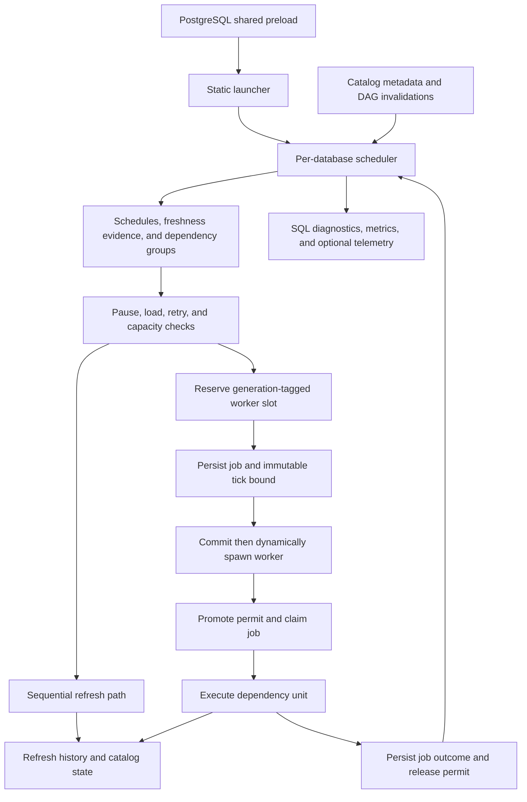

# Workers, freshness, resource ownership, and diagnostics

A freshness target is not a worker reservation or a promise that every wake-up changes data. The scheduler decides **when work is eligible**, dependency grouping decides **what must execute together**, admission controls decide **what can run now**, and refresh watermarks decide **which committed changes may be consumed**. Diagnose these separately.

For setup, start with [Quickstart](../quickstart.md). For the data side of this boundary, see [Change capture](../architecture/change-capture.md) and [Refresh correctness](../workflows/refresh-correctness.md).

## Runtime: from preload to a refresh outcome

`_PG_init()` registers configuration, but shared memory and the launcher are initialized only during `shared_preload_libraries` processing. Loading the library later does not enable background scheduling. The static launcher discovers databases and dynamically starts a coordinator named `pg_trickle scheduler` for each installed database. It waits on standbys until promotion, probes absent installations with backoff, and detects existing schedulers through `pg_stat_activity`; discovery is not a fixed ten-second guarantee because steady-state polling can be longer.

*Runtime flow: the coordinator owns eligibility and dispatch, while transactional refresh execution and durable outcomes remain distinct from shared-memory capacity.*

The coordinator recovers interrupted refresh records and reconciles orphaned jobs/tokens at startup. During normal operation it refreshes its dependency model when shared DAG state changes, evaluates work, and either runs the sequential path or dispatches dynamic refresh workers. In parallel dispatch, capacity is reserved **before** a durable job is enqueued; the job records unit membership, DAG version, dispatcher PID, slot generation, dispatch tick, and tick watermark. Spawns are deferred until after the enqueue transaction commits, so workers can see their job rows.

A worker connects to the specified database, promotes the reservation to a live slot, and atomically claims `QUEUED → RUNNING`. It rejects generation mismatches, obsolete DAG work, and legacy jobs missing their immutable tick bound. Completion is persisted before normal slot release. A durable job is therefore the handoff contract, not merely an in-memory queue entry. See the [dispatch implementation](../../src/scheduler/dispatch.rs).

## How freshness becomes eligible work

There are two related models in the scheduling code:

- **Interval freshness targets** use persisted controller state, including `next_due_at`, rather than relying solely on the legacy schedule string. The pure controller combines pending-change age, estimated execution cost, queue delay, load, semantic mode eligibility, memory limits, and explicit overrides. Missing age evidence for pending work makes it due rather than falsely safe. With known age and positive slack, overload can defer work. Its initial status distinguishes insufficient samples or unavailable evidence from meeting or at-risk performance; breach and infeasibility transitions use separate hysteresis.
- **Legacy schedules** can be duration-based, cron-based, or CALCULATED. Duration checks use `last_refresh_at`, including no-data runs, rather than only `data_timestamp`; tier multipliers and stable phase jitter can affect their effective timing. Cron checks use the cron matcher and do not receive duration tier multipliers. CALCULATED nodes propagate the minimum effective schedule of downstream dependants through the DAG, but runtime eligibility is driven by pending upstream changes. Schedule inheritance is not a reservation of execution time.

Unpopulated eligible tables need initialization. `MANUAL` declarations are scheduler-ineligible. IMMEDIATE tables refresh through triggers in the user's transaction, so ordinary schedule checks avoid competing for their locks. FULL queries with non-immutable expressions can require reevaluation even without source writes; interval targets still impose an interval between quiet clock-driven reevaluations.

**EXTERNAL orchestration is a boundary, not a slow schedule.** `check_schedule()` excludes EXTERNAL tables before ordinary initialization and due checks, and worker execution paths also guard against managed execution of external members. Do not use a shorter interval to make an externally coordinated table advance; inspect its orchestration owner instead.

### Dependency units are not always individual tables

The execution-unit DAG collapses diamond consistency groups and IMMEDIATE-trigger closures, constructs edges between units, and topologically orders them. It also represents cyclic SCC work, repeatable-read groups, and eligible fused chains. This prevents a scheduler from treating every branch of a consistency boundary as independent singleton work.

Diamond groups have a schedule policy: `fastest` becomes due when any member is due, whereas `slowest` waits for all members. Atomic-group execution refreshes members within one transaction; repeatable-read groups explicitly use that isolation level. Singleton workers use their own READ COMMITTED transaction. An IMMEDIATE closure preserves the trigger-driven downstream execution boundary rather than dispatching every triggered table independently. Independent ready units may run concurrently within the admitted budget.

The dispatcher polls completed jobs and advances downstream readiness. Importantly, its internal `succeeded` wave flag can also be set after permanent failure or exhausted retries **to let the wave terminate**. It is not proof that refreshed data is correct or current; consult job outcome and refresh history, not that readiness bookkeeping flag.

## Admission, failure, and resource ownership

### Capacity tokens are not correctness watermarks

Shared memory uses `PgLwLock`-protected structures and atomics for cross-process coordination. DAG invalidations have a bounded ring; overflow requests a full DAG rebuild rather than dropping correctness-critical metadata. Database scheduler slots keep database-local running state, queue depth, and tick information.

Dynamic-worker slots are generation-tagged reservations. Bind, promote, and release operations match the database/job/generation identity so a stale worker cannot release a newer incarnation's reservation. Admission combines the effective cluster limit, PostgreSQL parallel-worker limits, optional adaptive worker target, and a per-database quota with burst behavior. Increasing a table's freshness urgency does not bypass these ceilings.

Those permits answer **who may consume execution capacity**. By contrast, the persisted dispatch tick watermark and refresh frontiers answer **which changes belong to this execution**. Parallel dispatch declines to enqueue without a tick watermark, and workers reject jobs without the immutable bound. Never repair a capacity incident by manually advancing data frontiers. See [Refresh correctness](../workflows/refresh-correctness.md).

### PostgreSQL resources and backend-local state

Refresh exclusion is enforced with catalog-row `FOR UPDATE SKIP LOCKED`: a competing refresh skips work instead of waiting indefinitely or double-applying it. These row locks belong to the transaction, not to the shared worker token. Internal subtransactions save and restore PostgreSQL's `CurrentMemoryContext` and `CurrentResourceOwner` on commit or rollback; the RAII guard also rolls back on an unfinished drop. Error handling must preserve both PostgreSQL resource ownership and Rust control flow.

The memory policy bounds pg_trickle-owned accumulations such as the delta pipeline, template/plan cache, DAG queue, and invalidation ring. Change-buffer and window-state limits are guards, not permission to discard data; this is not a replacement for PostgreSQL executor-memory tuning. Component overrides can tighten a derived limit, not enlarge it.

Not all cache contents are shared. Delta templates are backend-local; a shared cache-generation change tells each backend to flush its local entries when it next checks. This generation is distinct from DAG versions and worker-slot generations. When investigating stale plans or memory growth, distinguish the shared invalidation signal from the process that actually owns cached data.

### Deferral and failure are different diagnoses

Load shedding applies to sequential and parallel scheduling. Deferred committed changes remain buffered and drain after pressure falls; exemptions and buffer guards keep deferral from being an unconditional stop. Retry backoff is another gate: retryable job failures update per-root retry state, successful jobs reset it, and permanent failures place member tables in `ERROR` as a dispatcher safety net. A no-data run, a load-deferred tick, lock contention, and an actual failed refresh are not interchangeable symptoms.

The dispatcher reaps RUNNING jobs whose worker PID is no longer live and reconciles stale slots against live workers, live schedulers, and queued jobs. Startup recovery separately marks interrupted refresh-history records failed. Diagnose both the catalog outcome and live process/permit state before assuming that a RUNNING row represents active execution. Recovery procedures belong in [Recovery and upgrades](recovery-and-upgrades.md).

## Enable, reload, drain, and stop

The scheduler processes SIGHUP with `ProcessConfigFile`; changes must reach the worker process, not merely the SQL session issuing `SET`. Use the [configuration guide](../../docs/CONFIGURATION.md) and [GUC catalog](../../docs/GUC_CATALOG.md) to distinguish reloadable controls from preload/postmaster settings.

`pg_trickle.enabled = off` makes the coordinator skip new scheduled work, but it continues to service drain requests. A CDC pause is a separate lossless consumption pause: capture stays active while consumption waits. These controls should not be confused with changing a table's lifecycle status or orchestration owner. For maintenance, use the [drain runbook](../../docs/RUNBOOK_DRAIN.md) rather than interpreting disabled scheduling as proof that every in-flight worker has stopped.

SIGTERM wakes the coordinator through its latch; it unregisters its database scheduler slot and clears scheduler metadata before leaving the loop. Dropping the extension is also detected and causes a clean exit. This graceful coordinator path is not a substitute for dead-worker reconciliation after crashes.

## Diagnose from SQL outward

Start with the smallest question, then correlate layers:

| Question | Inspect | Interpretation |
| --- | --- | --- |
| Is scheduling alive? | `pg_stat_activity`, `pgtrickle.worker_pool_status()` | Compare process presence, capacity, adaptive target, queue depth, and wake time. The shared last-wake timestamp is updated periodically, not on every millisecond tick. |
| Is this work queued, running, or finished? | `pgtrickle.parallel_job_status()` and `pgtrickle.pgt_scheduler_jobs` | The function includes all queued/running jobs and recently finished jobs, with unit kind, PIDs, and timing. Its default recent-history window is 300 seconds. |
| Did the refresh fail, skip, or find no data? | `pgtrickle.pgt_refresh_history`, `pgtrickle.refresh_timeline(...)` | Correlate execution history with job outcome; do not infer failure from unchanged data alone. |
| Is freshness evidence actually available? | `pgtrickle.pgt_freshness_controller_state` and interval-target metrics | Inspect sample availability, percentile freshness, decision reasons, and target status before treating a missing measurement as healthy. |
| Is this broader than one table? | `pgtrickle.health_check()`, `pgtrickle.health_summary()` | Use health diagnostics to identify capture, buffer, worker, and state problems before changing schedules. |

**Staleness and measured freshness are different contracts.** Monitoring tests explicitly check that no-data refreshes do not create false stale reports and that never-refreshed tables have unknown stale status. Exact controller freshness percentiles describe source-commit-to-visible observations; they are not simply time since the last scheduler wake or last data-changing refresh.

The `pg_trickle_alert` NOTIFY channel complements polling with events for refresh failures, falling behind, growing buffers, stuck watermarks, and freshness breach/recovery/infeasibility. Some scheduler reminders are throttled by successful emission time. Treat alerts as prompts to inspect current state and history, not as a replacement for them.

The built-in OpenMetrics endpoint is optional: port zero disables it. It runs inside the per-database scheduler, polling nonblocking sockets with bounded connection/request/response work and a collection deadline. A bind failure logs a warning and leaves the endpoint unavailable rather than disabling refreshes. Since each scheduler starts its own listener, verify listener ownership and port conflicts in multi-database deployments. Scrapes read bounded controller summaries for interval-target freshness instead of reconstructing percentile history on demand.

Use the existing [monitoring stack](../../monitoring/README.md) for Prometheus/Grafana integration and [Troubleshooting](../../docs/TROUBLESHOOTING.md) for incident procedures. Keep metrics reachable only where intended; the server's default helper binds loopback, while the scheduler uses the configured bind address.

Optional [OpenTelemetry integration](../../docs/OPENTELEMETRY.md) propagates W3C trace context from a session setting through CDC buffers and emits refresh spans when propagation is enabled and an endpoint is set. Export is best-effort on a background thread; failures do not fail refresh execution. Freshness metrics have a separate periodic export path when an endpoint is configured. Telemetry is diagnostic evidence, not a commit acknowledgement or correctness watermark.

## Focused verification and safe changes

Use [Change verification](../testing/change-verification.md) for test workflow and [Stream-table lifecycle](../architecture/stream-table-lifecycle.md) for status transitions. Relevant focused tests are:

- [`e2e_bgworker_tests.rs`](../../tests/e2e_bgworker_tests.rs): `test_auto_refresh_within_schedule`, `test_scheduler_writes_refresh_history`, and `test_pool_worker_does_not_run_while_disabled`. The disabled test observes a bounded three-second no-refresh window, then reenables work; it is not a universal proof that disabling cancels every in-flight execution.
- [`e2e_dag_concurrent_tests.rs`](../../tests/e2e_dag_concurrent_tests.rs): `test_dml_between_layer_refreshes`, `test_concurrent_insert_during_pipeline_refresh`, and `test_rollback_between_refreshes`. These exercise staged/manual refresh convergence and CDC isolation, not all dynamic-dispatch diamond policies.
- [`e2e_monitoring_tests.rs`](../../tests/e2e_monitoring_tests.rs): `test_no_data_refresh_does_not_cause_false_stale`, `test_pg_stat_stream_tables_stale_null_when_never_refreshed`, and `test_cache_stats_shape_and_monotonicity`. Preserve these observable contracts when changing timestamps, views, or cache accounting.

When extending scheduling, keep controller proposals separate from side-effecting admission; preserve unit boundaries, durable enqueue-before-spawn ordering, generation-matched cleanup, and immutable tick bounds. When extending monitoring, preserve unknown/evidence-unavailable states rather than converting missing evidence to a healthy zero.
