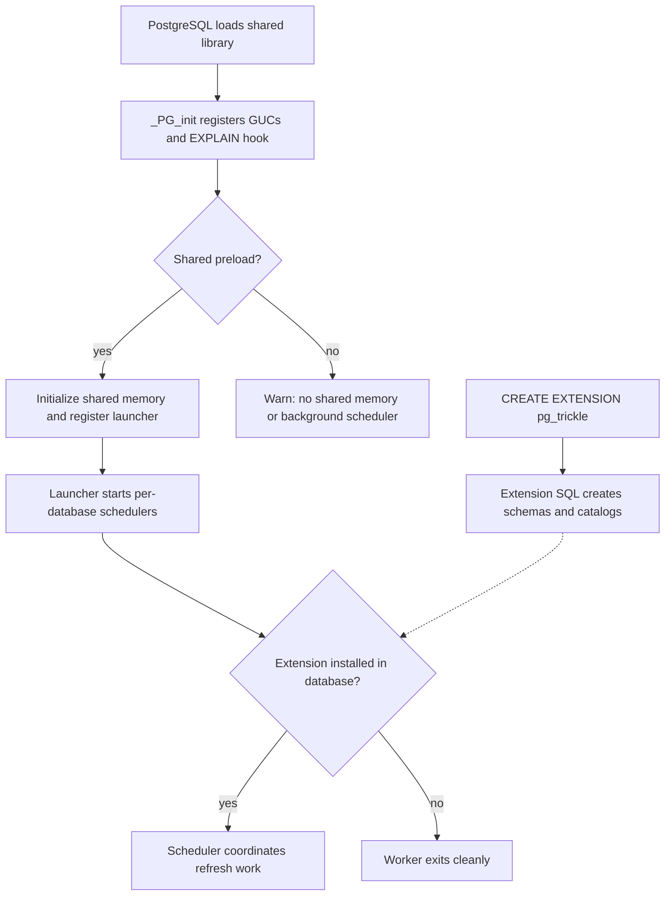

# Contributor quickstart and change-routing map

pg_trickle implements SQL-defined stream tables inside PostgreSQL, using differential view maintenance and automated refresh. **Correctness and durability of committed changes come before performance**; prefer differential maintenance, but never optimize away a safety boundary. Start with [AGENTS.md](../AGENTS.md) for conventions and test requirements and [CONTRIBUTING.md](../CONTRIBUTING.md) for contribution and PR workflow.

## Establish the environment

The current [Cargo manifest](../Cargo.toml) declares extension **0.108.3**, Rust **edition 2024**, PostgreSQL **18** as the default and only declared PostgreSQL feature, and exact **pgrx / pgrx-tests 0.18.0** dependencies. Match `cargo-pgrx` to that pin; do not infer compatibility from older examples.

Follow [INSTALL.md](../INSTALL.md) for platform prerequisites, `pg_config`, packaging, preload configuration, and installation. Once configured, run from the repository root:

```bash
just build
just fmt
just lint
just test-unit
```

`just build` compiles the extension; it does not install it into a server. `just lint` includes formatting, Clippy with warnings denied, security/privilege checks, documentation checks, and other repository contracts. Unit tests need no database, but **unit success alone does not validate SQL-facing behavior**. Select the next tier below. Use Testcontainers, not a local PostgreSQL instance, for integration and E2E tests.

## The runtime in one minute

Keep **server startup** separate from **database installation**:


*Library initialization provisions server coordination; extension SQL provisions database-local durable state.*

[`_PG_init`](../src/lib.rs) registers configuration and, during shared preload only, shared memory and the launcher. [`shmem`](../src/shmem.rs) coordinates sessions and schedulers with locks/atomics, including DAG invalidation; it is not a replacement for the persistent catalogs. The [scheduler](../src/scheduler/mod.rs) launcher discovers databases and manages per-database workers, which check installation before working.

SQL lifecycle calls enter [`api`](../src/api/mod.rs); [`catalog`](../src/catalog.rs) owns persistent metadata. Default capture uses statement-level AFTER triggers writing `pgtrickle_changes.changes_<oid>` **in the source transaction**; optional WAL capture feeds the same buffer boundary. [`dvm`](../src/dvm/mod.rs) differentiates the defining query into delta SQL, while [`refresh`](../src/refresh/mod.rs) executes maintenance for both manual and scheduled calls. Batch processing does not mean partial publication: refresh effects and progress finalize within the outer transaction. See [refresh correctness](workflows/refresh-correctness.md) before changing frontiers, cleanup, fallback, or downstream publication.

## Route the change, then choose its proof

The source column names the first ownership boundary, not every file to edit. Follow the linked domain page into its focused implementation and tests. E2E target names below are representative starting points, not a complete safety checklist.

| Task | Domain and first source owner | Smallest useful proof to start with |
|---|---|---|
| Create, alter, drop, dependencies, storage | [Stream table lifecycle](architecture/stream-table-lifecycle.md) → `src/api/`, `src/catalog.rs`, `src/dag.rs` | `just test-integration`; installed-extension lifecycle tests such as `e2e_create_tests`, `e2e_alter_query_tests`, `e2e_drop_tests` |
| Query admission, rewrites, delta operators, typed row identity | [Differential maintenance](concepts/differential-maintenance.md) → `src/dvm/` | `just test-unit`, then `just test-dvm`; installed-extension multi-cycle/equivalence tests |
| Trigger/WAL capture, visibility, buffer retention | [Change capture](architecture/change-capture.md) → `src/cdc/`, `src/wal_decoder.rs` | Installed-extension `e2e_stmt_cdc_tests`, `e2e_long_txn_visibility_tests`, WAL receipt/recovery tests as applicable |
| Refresh execution, IMMEDIATE mode, atomic publication | [Refresh correctness](workflows/refresh-correctness.md) → `src/refresh/`, `src/ivm.rs`, API refresh entrypoints | `e2e_refresh_atomicity_tests`, `e2e_diff_full_equivalence_tests`; immediate/concurrency tests for that mode |
| Privileges, caller identity, user SQL, error handling | [Security boundaries](architecture/security-boundaries.md) → `src/api/security_context.rs`, `src/error.rs` | `just lint` boundary checks plus ownership/RLS/security E2E regressions |
| Freshness, workers, GUCs, diagnostics | [Scheduling and observability](operations/scheduling-and-observability.md) → `src/scheduler/`, `src/shmem.rs`, `src/config/`, `src/monitor/` | Pure decision tests first; `e2e_scheduler_tests`, `e2e_bgworker_tests`, monitoring tests for runtime behavior |
| Crash/restore, repair, snapshots, SQL upgrades | [Recovery and upgrades](operations/recovery-and-upgrades.md) → `src/api/recovery.rs`, snapshot API, `src/version.rs`, `sql/` | Failure-recovery, dump, and upgrade E2E tests matching the changed persistence boundary |
| External graph coordination or output consumers | [Consumer contracts](integrations/consumer-contracts.md) → `src/api/integration.rs`, `src/api/output_delta.rs`, `src/integration_contract.rs` | Public conformance tests and publication crash/atomicity regressions |
| dbt materialization | [dbt integration](integrations/dbt-materialization.md) → `dbt-pgtrickle/macros/`; follow its [AGENTS.md](../dbt-pgtrickle/AGENTS.md) | `just test-dbt` after macro changes |

Security is a cross-cutting constraint: privileged lifecycle access to private state must not execute user SQL as the extension owner. Preserve the caller/stream-owner execution context and its restoration.

## Run only what proves the change—but prove it

- **Generated SQL:** `just test-dvm` executes DVM component tests against Testcontainers PostgreSQL. It complements, rather than replaces, tests with the installed extension.
- **Installed extension:** `just test-light-e2e` packages the extension into stock PostgreSQL for eligible targets. Check [the runner](../scripts/run_light_e2e_tests.sh) for eligibility. `just test-e2e` rebuilds the custom image and runs full E2E. Fast variants reuse artifacts: stale packages/images can invalidate the result.
- **Correctness regressions:** prefer repeated mutation/refresh cycles compared with a fresh defining-query result. For concurrency, demonstrate overlap with a barrier or observed database state; poll for completion rather than relying on fixed sleeps.
- **Before merge:** consult [change verification](testing/change-verification.md) and [CI coverage](../docs/CI_COVERAGE.md). A manual full CI run is recommended for DVM, refresh, or CDC changes; `just test-all` does not include ignored TPC-H tests (`just test-tpch`).

## Keep the authoritative references close

Use [README](../README.md) and [ESSENCE](../ESSENCE.md) for product orientation, [architecture](../docs/ARCHITECTURE.md) for the broader design, and the [justfile](../justfile) for executable commands. For contracts, consult the [SQL reference](../docs/SQL_REFERENCE.md), [configuration guide](../docs/CONFIGURATION.md), [GUC catalog](../docs/GUC_CATALOG.md), and [known limitations](../README.md#known-limitations), rather than copying their matrices or defaults here. Source and representative tests decide behavior when descriptive references lag.
