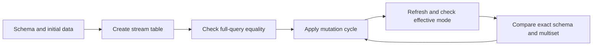

# Choosing and extending correctness verification

Correctness evidence must cross the boundary changed by the patch. A pure Rust decision test is useful for a classifier, but cannot establish SQL execution, publication atomicity, or worker recovery. Start with the narrowest meaningful assertion, then add the runtime tier needed to expose the failure. This page describes **inspected test assertions and verification machinery, not a report of passing runs**; no tests were executed while preparing it.

For the underlying contracts, see [differential maintenance](../concepts/differential-maintenance.md), [refresh correctness](../workflows/refresh-correctness.md), [change capture](../architecture/change-capture.md), and [recovery and upgrades](../operations/recovery-and-upgrades.md).

## Choose the boundary before the command

The [development guidelines](../../AGENTS.md#testing) require Testcontainers for integration and E2E work, **not a developer's local PostgreSQL database**. Reuse the shared harnesses and cover failure as well as success. For code changes, run `just fmt` and then `just lint`, with zero warnings, before the focused runtime checks. The pgrx-managed backend tier below is a distinct supported recipe, not permission to substitute a personal database for Testcontainers.

| Tier | Command and actual scope | What it does not establish |
|---|---|---|
| Pure Rust/stub unit | `just test-unit` runs library tests through `scripts/run_unit_tests.sh`. A C stub satisfies PostgreSQL link symbols using `LD_PRELOAD` or `DYLD_INSERT_LIBRARIES`; the default cargo path runs single-threaded. | The stub is not a PostgreSQL implementation. Backend-dependent behavior needs another tier. |
| Catalog/SQL integration | `just test-integration` selects named targets such as `catalog_tests`, `catalog_compat_tests`, `workflow_tests`, and `property_tests`. `TestDb` starts stock PostgreSQL and can install generated catalog DDL. | Installing fixture DDL is not loading the extension or exercising workers. |
| Generated DVM SQL execution | **Separately run `just test-dvm`**. Its runner uses pure Rust `DiffContext` logic, pg_stub for linking, and sqlx against Testcontainers to execute generated SQL. | Standalone identity functions are typed BYTEA test substitutes, not the production row encoder. |
| Packaged light E2E | `just test-light-e2e` packages the extension, then runs a curated target list with `light-e2e`. Stock PostgreSQL loads the actual extension on demand. | No preload, scheduler, background worker, or extension shared-memory initialization. |
| Full E2E | `just test-e2e` rebuilds the custom image and runs `e2e_*` targets through the full runner. The default `E2eDb` harness supports preload, workers, and shared memory. | Ignored workloads are not automatically exercised. |
| pgrx backend | `just test-pgrx` invokes `cargo pgrx test pg18` with the default PostgreSQL selection. | Not a replacement for external-client or Docker lifecycle tests. |
| pg_regress fixtures | `tests/pg_regress/sql/setup.sql` creates the extension in a regression database. | This is setup scaffolding, not evidence of a populated SQL regression suite: the inspected justfile and CI do not expose a separate pg_regress recipe. |

These distinctions come from the [recipes](../../justfile), [unit runner](../../scripts/run_unit_tests.sh), [DVM runner](../../scripts/run_dvm_integration_tests.sh), and [shared integration harness](../../tests/common/mod.rs). In particular, **`just test-all` means unit + named integration + full E2E + pgrx**. It does not include `test-dvm`, dbt, or ignored TPC-H tests merely because its name says “all.”

### Light eligibility and artifact freshness

Consult the actual [`LIGHT_E2E_TESTS` allowlist](../../scripts/run_light_e2e_tests.sh), not the `e2e_` prefix. The list includes lifecycle, operator, identity, security, corpus, and LSN targets, but that does not make every test function in those files a light-compatible worker test. Explicit `--test` arguments are accepted directly rather than checked against the allowlist; choosing a target manually is therefore **not** an eligibility check. Inspect feature guards and helper dependencies before adding a target.

The current runner installs package files into a shared stock container **before starting its postmaster**, then selects the light harness with the Cargo feature. See the [light harness limitations](../../tests/e2e/light.rs): auto-refresh is unavailable, and GUC registration on demand may differ across connections. Packaging on non-Linux hosts uses a Linux builder container.

- `just test-light-e2e-fast` omits forced packaging, but the runner packages if no valid package directory exists. A valid directory can still be stale; use the non-fast command after extension changes.
- `just test-e2e-fast` skips rebuilding the full image. Run `just build-e2e-image` first when its extension artifacts are stale. The same caution applies to other build-skipping runners.
- `just test-tpch` explicitly runs ignored TPC-H coverage and rebuilds its image; `TPCH_CYCLES=5 just test-tpch` controls mutation cycles. `just test-all` excludes this ignored tier.
- `just test-dbt` is a separate Docker/dbt contract tier; `just test-dbt-fast` skips its image rebuild. See [dbt materialization](../integrations/dbt-materialization.md).

## Change-to-focused-test matrix

Use these as starting points, not a promise that one file covers every scenario. A new assertion should reproduce the changed invariant and fail against a meaningful negative control.

| Change class | Smallest useful starting evidence | Escalate when the boundary requires it |
|---|---|---|
| Lifecycle: create, alter, replace, drop | Named catalog integration targets; light `e2e_lifecycle_tests`, `e2e_create_or_replace_tests`, `e2e_alter_query_tests` | Full E2E for worker-visible invalidation, scheduled dependencies, or restart behavior |
| Operators and identity | Unit generation logic + `just test-dvm`; light `e2e_diff_full_equivalence_tests`, `e2e_keyless_duplicate_tests`, `e2e_row_id_v2_tests` | Actual packaged encoder, multi-cycle joins/aggregates, composition, and strategy variants |
| Frontiers and CDC visibility | Unit LSN/version logic; light-compatible cases in `e2e_lsn_contract_tests` and `e2e_watermark_gating_tests` | Full `e2e_long_txn_visibility_tests`, WAL transitions, scheduler holdback and malformed persisted frontiers |
| Refresh atomicity | Full `e2e_refresh_atomicity_tests` | Manual and scheduler paths, auxiliary state, caller/savepoint rollback, competing refreshes and writers |
| Worker recovery and durability | Full `e2e_failure_recovery_tests`, `e2e_dvm_failpoint_tests` | `e2e_wal_receipt_recovery_tests`, `e2e_publication_crash_recovery_tests`, window-state recovery and real restarts |
| Privilege boundaries | Light-eligible RLS, ownership, and versioned security targets | Full `e2e_v1150_maintain_grantee_refresh_tests` for exact-target MAINTAIN and graph refresh authorization |
| Migration parity | `catalog_compat_tests`, then `e2e_upgrade_tests` | Dedicated upgrade images and `just test-upgrade` / `just test-upgrade-all` for the supported migration chain |
| Integration contracts | `e2e_v104_conformance_tests`, `just test-v108-conformance`, reference clients | dbt, PgBouncer, publication/subscription, or pipeline-specific runners rather than internal catalog-only assertions |

## Differential evidence: compare contents, not counts

The central oracle is the defining full query evaluated over the current sources. A maintained stream table should equal that result as a **multiset**: duplicate multiplicity matters. Symmetric `EXCEPT ALL` checks both extra and missing rows; a row count, checksum alone, or ordinary set difference can miss same-count substitutions and duplicate errors.

The [exact E2E oracle](../../tests/e2e/oracle.rs) also compares ordered column signatures: names, type OIDs, typmods, and collations. It reports concrete extra/missing rows and schema mismatches, and represents comparison errors as failures rather than equality. Use `assert_st_query_exact` and, where differential execution itself is the subject, `assert_effective_refresh_mode`. Otherwise a correct FULL fallback can conceal a broken differential route. [`e2e_sensitivity_baseline_tests`](../../tests/e2e_sensitivity_baseline_tests.rs) supplies deliberate wrong-content, multiplicity, and schema cases to test the oracle itself.

A useful extension is a history, not just initial population plus one insert:

*The scenario runner checks maintained results across mutation cycles rather than only at creation.*

Exercise deletes, updates, NULL groups, duplicate rows, empty-to-nonempty transitions, and simultaneous changes on multiple leaves. The [multi-cycle suites](../../tests/e2e_multi_cycle_tests.rs) and [property tests](../../tests/e2e_property_tests.rs) are useful patterns. Property-generated histories broaden inputs; they do not prove all possible histories. Metamorphic tests check relationships between executions: for example, [`test_v0874_refresh_batching_and_multi_source_history`](../../tests/e2e_dvm_metamorphic_tests.rs) asserts that split and batched refresh histories converge, remain differential, and match the full query. Strategy tests replay corpus cases across refresh/CDC configurations.

### Preserve and reduce failures

The [versioned DVM scenario runner](../../tests/e2e/dvm_fuzz/mod.rs) records seed, generator/format version, schema, initial data, defining query, mutation cycles, execution settings, expected mode, and features. Failures carry invariant, class, phase, cycle, mutation, and optional relation diffs. The [permanent corpus test](../../tests/e2e_dvm_corpus_tests.rs) replays stored scenarios **without regenerating them**; reproduction should survive generator changes.

Keep the original failure, then shrink while preserving the relevant failure class. The [in-process shrinker](../../tests/e2e/dvm_fuzz/shrink.rs) removes cycles and individual mutations only when the failure predicate remains true. [`scripts/dvm_shrink.py`](../../scripts/dvm_shrink.py) additionally reduces initial-data rows. Retain the reduced JSON and use [`scripts/dvm_replay.py`](../../scripts/dvm_replay.py) against a disposable container database. Update the explicit corpus selection when adding a regression; placing JSON in a directory alone is not proof it runs. Active negative controls must fail with their declared class, not merely fail for any reason.

## Concurrency and crashes need witnesses

A sleep does not establish which interleaving was tested. The [atomicity suite](../../tests/e2e_refresh_atomicity_tests.rs) holds advisory-lock barriers at `input_boundary`, `after_apply`, and `during_finalize`; it observes a backend's application name, lock wait, and blocking PID before proceeding. Tests inspect committed output together with frontier, timestamps, population state, successful history, and output-delta progress. Failure injection, caller rollback, and savepoint rollback are intended to leave the committed checkpoint unchanged, with later recovery converging to the query result. The [DVM failpoint regression](../../tests/e2e_dvm_failpoint_tests.rs) additionally inspects scheduler failure evidence and recovery on a retained corpus scenario.

For WAL/crash changes, distinguish “client reconnected” from “the same durable database recovered.” [`e2e_wal_receipt_recovery_tests`](../../tests/e2e_wal_receipt_recovery_tests.rs) tracks a sentinel, system identifier, database OID, container ID, and volume identity, and coordinates phases before receipt, replay, acknowledgement, and after slot advance. [`e2e_publication_crash_recovery_tests`](../../tests/e2e_publication_crash_recovery_tests.rs) exercises publisher/subscriber restart and catch-up with server identity checks. Preserve these identity witnesses and independent committed-source evidence when extending tests; rebuilding an empty fixture is not crash recovery. These are targeted schedules, not an exhaustive proof of durability under every failure.

For security work, assert both authorized success and unauthorized rejection under real roles, and verify that rejection does not mutate state. Use [RLS](../../tests/e2e_rls_tests.rs), [ownership](../../tests/e2e_ownership_tests.rs), and [exact-target MAINTAIN](../../tests/e2e_v1150_maintain_grantee_refresh_tests.rs) patterns; do not infer authorization from a superuser-only happy path. See [security boundaries](../architecture/security-boundaries.md).

For migrations, distinguish fresh-install schema checks from running the actual upgrade chain. The [upgrade suite](../../tests/e2e_upgrade_tests.rs) includes function parity with a fresh install, surviving stream tables, and migration-specific backfills. Public integration tests should use the [reference clients](../../tests/conformance/reference_clients.rs) for graph digests, refresh, delta registration, resnapshot and acknowledgement rather than treating private tables as the public API.

## Formal LSN scope is narrower than runtime correctness

[`verification/lsn.rs`](../../verification/lsn.rs) is production code imported by the extension, not a disconnected model. The [specification](../../verification/lsn-specification.md) describes checked byte parsing of one-to-eight hexadecimal digits on each side of `/`, unsigned 64-bit packing and ordering, and canonical uppercase formatting with an eight-digit low half and parse/format round-trip identity.

[`check_lsn_verification.py`](../../scripts/check_lsn_verification.py) uses pinned Verus, requires named obligations and a zero-error summary, and requires a semantic mutation of `pack_halves` to fail verification. **That machinery must actually run successfully before claiming proof.** The specification records independent specification review as pending. Allocation and UTF-8 construction adapters are outside the model; PostgreSQL WAL durability, scheduling, CDC holdback, and whole-extension correctness are explicitly excluded.

[CI](../../.github/workflows/ci.yml) therefore adds packaged and full runtime LSN contract tests and [`check_lsn_candidate_binding.py`](../../scripts/check_lsn_candidate_binding.py), binding proof records to candidate and installed-library attestations. A checked arithmetic core is not an end-to-end recovery guarantee, nor does proof about one source revision automatically attest to a different installed binary.

## CI and release evidence are separate layers

- [Main CI](../../.github/workflows/ci.yml) wires fast checks, packaging, selected runtime suites, and candidate evidence. Before merging DVM, refresh, or CDC changes, the guidelines recommend `gh workflow run ci.yml --ref <branch-name>`; inspect current triggers and actual selected tests rather than assuming every push runs every tier.
- [DVM deep tiers](../../.github/workflows/dvm-tiers.yml) run bounded nightly corpus/composition/metamorphic/shrink coverage; weekly adds strategy, failpoints, negative controls, ignored workload combinations, and extended fuzzing.
- [Stability tests](../../.github/workflows/stability-tests.yml) are scheduled/manual, separate from PR/merge gating. They run soak, multi-database isolation, and Citus chaos checks, with their own final gate.
- [Release workflow](../../.github/workflows/release.yml) invokes DVM, identity, and versioned qualification gates. [`dvm_release_gate.py`](../../scripts/dvm_release_gate.py) without `--database` performs structural checks and reports database-dependent work as skipped; it is not live correctness evidence. The [v0.108.3 gate](../../scripts/v0_108_3_release_gate.py) enumerates required atomicity, sensitivity, recovery, publication and upgrade cases as well as support-contract checks.

When reporting a change, give the exact command, selected target/filter, harness, artifact freshness, and outcome. Separate assertions inspected from tests executed, skipped/ignored work from exercised paths, and intended invariants from established evidence. A structural release-gate success or a green focused test does not silently qualify every supported deployment.
