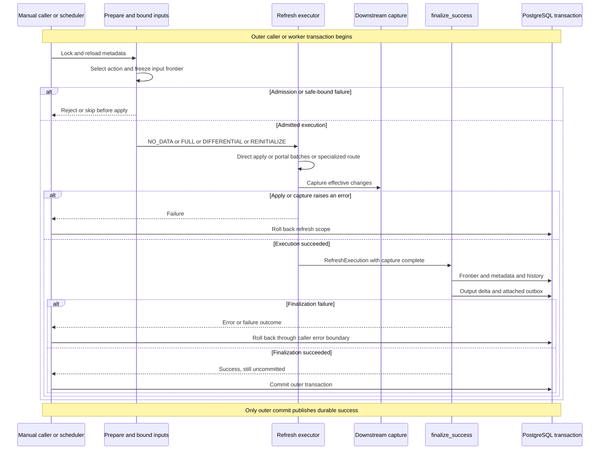

# Refresh execution and atomic publication

A refresh is not complete when target rows have been written. Its target contents, consumed-input frontier, downstream change capture, completed history, output-delta checkpoint, and attached outbox must describe the same successful execution. Manual and scheduled callers converge on `RefreshExecution` and `finalize_success`; IMMEDIATE maintenance instead runs synchronously inside the source writer's transaction. Do not infer an execution algorithm or transaction boundary from the configured word `DIFFERENTIAL`.

## Entrypoints and ownership

| Entry | Coordination and execution | Publication boundary |
| --- | --- | --- |
| `pgtrickle.refresh_stream_table` | `refresh_stream_table_impl` resolves and authorizes the table, rejects recovery/hold-mode consumption and inappropriate status or orchestration, takes a transaction advisory lock and catalog row lock, then reloads metadata before `execute_manual_refresh`. | The SQL caller's transaction, including an explicit transaction that continues after the function returns. |
| Scheduled refresh | Scheduling selects an action and calls `execute_scheduled_refresh` with a tick watermark. Catalog `FOR UPDATE SKIP LOCKED` coordination prevents overlapping scheduled/manual work. Ordinary scheduled execution has a subtransaction/error boundary inside the tick. | The worker/tick transaction, not completion of an individual SPI statement or release of an internal subtransaction. |
| IMMEDIATE source DML | Statement-level BEFORE triggers coordinate writers; AFTER triggers use transition tables to compute and apply a delta. | The source DML transaction. No separate scheduled CDC-consumption cycle is required for the IMMEDIATE target. |
| Graph refresh | The graph coordinator locks sources, captures one safe bound, and executes members through the manual executor in graph context. | One graph caller transaction; members do not publish separate commits. |

The manual advisory key is `pgt_id`. It is a **try** transaction lock: contention returns `RefreshSkipped`. The additional catalog row lock makes manual work visible to the scheduler; after both locks, reloading the frontier prevents replaying changes consumed by a refresh that won the earlier race. Definition-derived SQL executes as the stored stream owner with the stored search path; privileged CDC staging and catalog bookkeeping are separate from that owner execution. Missing required buffers and invalid row identity are correctness errors, not permission to treat a source as unchanged. [Manual caller](../../src/api/refresh_ops.rs#L171-L333), [scheduled isolation](../../src/scheduler/mod.rs#L3414-L3475), [bounded staging](../../src/refresh/delta_stage.rs#L23-L119).

*Manual/scheduled execution and its failure exits. Scheduler rollback handling depends on its error/outcome wrapper; IMMEDIATE triggers use the source transaction rather than this finalizer sequence.*

## Freeze the consumed window, not just a timestamp

Ordinary differential inputs are `(previous_lsn, new_lsn]` for each dependency. `DeltaStage::prepare` copies those windows into private temporary relations before switching execution identity. Stream-table dependencies use the `pgt_<id>` frontier namespace and may resolve to a same-pass bypass relation rather than the persistent buffer. Neither later WAL movement nor a portal fetch is allowed to enlarge that refresh's input window.

Manual differential refresh without an enclosing safe-bound context captures a candidate WAL LSN **before** probing other writers. Its current writer-lock proof requires READ COMMITTED; repeatable-read/serializable return `SafeFrontierUnavailable`. If another relevant writer holds a conflicting relation lock, the upper bound becomes `0/0` rather than advancing past potentially invisible CDC. New frontiers merge with the previous frontier, so a trailing bounded position cannot move progress backward. Graph context supplies its pre-established bound instead. [Window construction](../../src/api/refresh_ops.rs#L1017-L1082), [stage selection and copy](../../src/refresh/delta_stage.rs#L23-L103).

FULL is a different proof: source relations and upstream stream tables are locked before rebuilding a baseline. The manual FULL path snapshots upstream buffer positions **before** `TRUNCATE`/`INSERT`, capped by its safe bound, then stores base and stream-table positions. Capturing positions after the INSERT under READ COMMITTED could skip an upstream commit the INSERT never read. [Manual baseline](../../src/api/refresh_ops.rs#L616-L759), [frontier storage](../../src/api/refresh_ops.rs#L884-L953).

There is an important scheduled mixed-mode distinction: a protected FULL baseline reads current locked upstream contents, including same-tick changes above the tick watermark. Its upstream position is therefore the actual buffer `MAX(lsn)`, **uncapped**. Only differential windows retain `LEAST(MAX(lsn), safe_bound)`. If a differential attempt becomes FULL during execution, scheduled finalization rereads the upstream positions as a FULL baseline. This avoids subsequently applying changes already included in that locked rebuild. It is not correct to replace all these positions with `pg_current_wal_lsn()` or impose one identical baseline rule on every caller. [Scheduled baseline and same-tick rule](../../src/scheduler/mod.rs#L3893-L4032), [fallback frontier repair](../../src/scheduler/mod.rs#L4322-L4339).

## Requested action versus actual work

The basic scheduled decision gives `needs_reinit` priority, then NO_DATA for no upstream changes, otherwise FULL or DIFFERENTIAL according to mode. IMMEDIATE tables are normally excluded from scheduling; a manual rebuild of one is FULL. Manual dispatch separately prioritizes TopK, reinitialization, configured FULL/IMMEDIATE, and DIFFERENTIAL; missing or empty differential frontiers require a FULL baseline. [Decision](../../src/refresh/orchestrator.rs#L14-L59), [manual dispatch](../../src/api/refresh_ops.rs#L340-L444), [missing baseline](../../src/api/refresh_ops.rs#L967-L1015).

NO_DATA can advance processed progress/refresh bookkeeping without advancing `data_timestamp`. A differential execution that writes no rows similarly stores its frontier while preserving the timestamp, avoiding false wakeups of downstream CALCULATED tables. Manual FULL also detects certain no-op baselines using upstream timestamps and source positions. Do not use a fresh `last_refresh_at` alone as proof of changed output. [No-op handling](../../src/api/refresh_ops.rs#L903-L953), [differential completion](../../src/api/refresh_ops.rs#L1119-L1135), [shared finalization](../../src/refresh/mod.rs#L949-L963).

### DIFFERENTIAL is an admitted strategy family

There are three distinct kinds of routing; they must not all be described as “try MERGE, then FULL.”

1. **Admission rejects unsafe incremental forms.** Current `incremental_admission` classifies INTERSECT/EXCEPT as FullOnly, including their ALL forms through the parsed operator. Explicit incremental-mode validation resolves that admission before execution. FULL materializes the defining-query shape and normalizes legacy dual-count storage; the existence of set-operation helpers/private state is not an incremental-admission guarantee. [Admission](../../src/dvm/parser/validation.rs#L80-L155), [stored-query validation](../../src/api/mod.rs#L1560-L1597), [FULL set-operation handling](../../src/api/refresh_ops.rs#L670-L685).
2. **Correctness/compatibility redirects or rejects execution.** The shared executor rechecks row identity, buffers, and owner-visible RLS. RLS can redirect shared execution to FULL, whereas manual prevalidation can reject an incremental query earlier. Mutable CASE/IN-list aggregate drift, an unsuccessfully decorrelated scalar aggregate subquery, uncertain CASE/subquery classification, excessive join count, and the configured delta-fraction guard can return `QueryTooComplex`; manual and scheduled callers catch that variant and run FULL. Other errors are not blanket FULL retries. A function-body hash change instead marks reinitialization and returns zero work for that cycle. [Runtime guards](../../src/refresh/merge/mod.rs#L724-L931), [delta-fraction guard](../../src/refresh/merge/mod.rs#L1004-L1045), [manual catch](../../src/api/refresh_ops.rs#L1084-L1111), [scheduled catch](../../src/scheduler/mod.rs#L4214-L4275).
3. **Adaptive choice changes the implementation.** After detecting changes, forced FULL, `refresh_strategy = full`, delta ratio, buffer-row limit, historical cost prediction, or aggregate saturation can choose FULL. `refresh_strategy = differential` bypasses ratio/cost/saturation heuristics, not all safety, admission, or complexity checks; the buffer check still applies. Per-leaf fallback is different again: it changes snapshot reconstruction from NOT EXISTS to EXCEPT ALL for selected leaves without making the whole refresh FULL. [Adaptive branches](../../src/refresh/merge/mod.rs#L1571-L1882).

Specialized routes also matter:

- **TopK:** re-executes ORDER BY/LIMIT and merges the bounded result, rather than deriving an ordinary incremental delta. Manual dispatch uses this route regardless of configured mode. Scheduled dispatch also bypasses ordinary executors and supplies `TopKRecompute` reason metadata.
- **Windows:** current production plans retain partition recomputation; runtime state-backed window execution is test-enabled rather than a general production promise. A downstream manual differential consumer of a TopK or persisted window-strategy upstream is redirected to FULL. The number of stream-table dependencies alone is not a fallback criterion.
- **Ordinary apply:** explicit DELETE/UPDATE/INSERT is forced when downstream consumers need effective capture. User-trigger/keyless constraints also affect routing. PH-D1 DELETE+INSERT, join conflict handling, distributed targets, partitioned targets, algebraic aggregate fast paths, and the narrowly admitted vectorized COUNT/SUM/AVG producer are not interchangeable with ordinary MERGE. The PH-D1 reconciliation layer can correct orphan, stale, and missing result multiplicities against a reconstructed query result.

[TopK dispatch](../../src/api/refresh_ops.rs#L382-L395), [scheduled TopK](../../src/scheduler/mod.rs#L4083-L4095), [window runtime status](../../src/refresh/merge/mod.rs#L737-L753), [upstream compatibility](../../src/api/refresh_ops.rs#L1217-L1237), [apply admission](../../src/refresh/merge/mod.rs#L2630-L2785), [reconciliation](../../src/refresh/phd1.rs#L66-L95).

## Batches and savepoints are not publication units

`decide_pipeline` keeps small, proven non-amplifying deltas direct, selects a portal for large or potentially amplifying ordinary deltas, and retains direct compatibility paths for excluded shapes. The actual caller additionally excludes DELETE+INSERT and algebraic aggregates. Pipeline reason metrics distinguish `small_non_amplifying`, `large_input`, `potential_amplification`, and `compatibility_fallback`.

The portal uses a temporary batch relation, fetches at most `min(256, batch_size)` tuples per iteration, applies the MERGE shell to that batch, and truncates the **temporary** relation before fetching again. Its byte limit is measured for statistics/oversize accounting here, not a guarantee that a single batch cannot exceed that byte count. It does not commit a batch, stream progressive target output to other sessions, or release outer transaction locks early. Frontier and durable history are finalized once through the normal caller. Internal subtransaction “commit” likewise releases a savepoint into its parent; it is not a PostgreSQL transaction commit. [Pipeline contract and admission](../../src/refresh/pipeline.rs#L1-L75), [batch execution](../../src/refresh/pipeline.rs#L274-L349), [caller exclusions](../../src/refresh/merge/mod.rs#L2739-L2759).

## Publish the effective change, then finalize

For an upstream FULL refresh with consumers, execution snapshots old user columns and row identity before replacement, then compares pre/post contents into `changes_pgt_<id>`. Changed values become D/I pairs; duplicate identities are paired by occurrence so added/removed multiplicities are not lost. Differential explicit DML uses an affected-row pre/post comparison to publish the **effective** changes rather than assuming every raw generated delta changed storage. Both routes validate the downstream buffer and propagate capture errors. Graph capture uses the graph bound for its event LSN so same-pass consumers can read it. [Capture SQL and wrappers](../../src/refresh/codegen.rs#L1275-L1501).

`finalize_success` first requires `downstream_capture_complete`. It stores the frontier, updates changed/no-data metadata, completes history with actual rows and strategy, persists typed reason/effective-mode information, finalizes output-delta capture, and writes an attached outbox when rows changed. FULL/REINITIALIZE without a typed reason is a finalization error. `requested_action`, effective action, `merge_strategy_used`, and `was_full_fallback` must be read together; a configured DIFFERENTIAL table may have executed FULL or a specialized implementation. Required durable writes propagate errors instead of reporting successful partial finalization. [Finalizer](../../src/refresh/mod.rs#L927-L1124).

Cleanup is consumer-frontier based, not “delete the upstream buffer after one child ran.” Stream-table cleanup skips buffers with uninitialized consumers and deletes I/D rows only through the minimum recorded downstream frontier. Graph refresh suppresses per-member ST cleanup, runs members at one shared bound, and cleans after all members execute; otherwise an equal-bound same-pass event could disappear before a later member reads it. [Cleanup threshold](../../src/refresh/codegen.rs#L637-L708), [graph exclusion](../../src/refresh/merge/mod.rs#L1071-L1078), [graph orchestration](../../src/api/integration.rs#L1007-L1098).

## IMMEDIATE is not scheduled CDC at zero delay

IMMEDIATE's BEFORE statement triggers lock by **target relation OID**, not the manual `pgt_id` key. Complex queries use blocking `pg_advisory_xact_lock`; the simple scan-chain `RowExclusive` route uses `pg_try_advisory_xact_lock` and relies on row-level concurrency rather than a universal blocking serialization promise. AFTER triggers read transition tables and apply owner-executed delta DML inside the writer transaction. Effective pre/post capture makes those changes available to deferred downstream consumers too. [Lock selection](../../src/ivm.rs#L60-L108), [trigger locks](../../src/ivm.rs#L335-L408), [effective capture](../../src/ivm.rs#L679-L784).

TRUNCATE has no row transition delta: `pgt_ivm_handle_truncate` rebuilds the target and persisted aggregate auxiliary columns from the now-current query, then captures a FULL pre/post diff for deferred children. It is not a per-row DELETE equivalent. FULL replacement suppresses application triggers selectively while preserving IVM maintenance triggers, so IMMEDIATE descendants remain synchronized. Failure/rollback belongs to the source/replacement transaction. [TRUNCATE](../../src/ivm.rs#L1325-L1469), [trigger preservation](../../src/api/refresh_ops.rs#L687-L700).

For a mixed-mode IMMEDIATE closure, the worker refreshes only the scheduled root. Descendant triggers fire synchronously in the same READ COMMITTED transaction; the coordinator must not independently schedule each IMMEDIATE member. A deferred differential child is a separate consumer of durable captured changes. If an IMMEDIATE upstream buffer is missing, the manual path creates it and performs one FULL baseline rather than pretending historical deltas exist. [Closure execution](../../src/scheduler/mod.rs#L441-L462), [buffer recovery](../../src/api/refresh_ops.rs#L993-L1004).

## Failure semantics and verification boundaries

A caller rollback undoes target and auxiliary-state writes, frontier movement, successful history, downstream capture, output-delta payload/checkpoint, and transactional outbox writes made in that scope. Manual failure history written inside the failed SQL transaction is not an autonomous audit commit. The scheduled panic/PG-error wrapper rolls back the refresh subtransaction and can record failure/status in the still-live parent transaction. Do not confuse that separately recorded failure with a committed successful frontier. Also do not assume shared-memory metrics, notices, or external hook side effects have the same rollback semantics as durable PostgreSQL rows.

A review-sensitive boundary remains: the ordinary scheduler wrapper explicitly rolls back panics and `AtomicityTestFailure`, but releases the subtransaction for other returned `RefreshOutcome`s. Some finalization errors become returned retryable/permanent outcomes. Therefore the barrier tests are evidence for their injected error paths, **not** a proof that every possible structured error after mutation rolls back. New executor/finalizer errors need review through the actual caller wrapper. [Outcome handling](../../src/scheduler/mod.rs#L3441-L3475), [finalization error conversion](../../src/scheduler/mod.rs#L4354-L4374).

Focused tests provide complementary evidence (test definitions inspected here, not executed as part of this documentation):

| Evidence | What it exercises |
| --- | --- |
| [Refresh atomicity](../../tests/e2e_refresh_atomicity_tests.rs) | Advisory barriers at `input_boundary`, `after_apply`, and `during_finalize`; manual/scheduled injected failure pairs; caller and savepoint rollback; competing refreshers; a concurrent writer retained for the next batch; auxiliary-state rollback; negative controls detecting early progress and partial output-delta finalization. |
| [IMMEDIATE concurrency](../../tests/e2e_immediate_concurrency_tests.rs) | Concurrent inserts, distinct/same-row updates, deletes, and mixed DML stress. This is workload coverage, not proof for every isolation level/query shape. |
| [IMMEDIATE integration](../../tests/e2e_ivm_tests.rs) and [DAG rollback](../../tests/e2e_dag_immediate_tests.rs) | FULL upstream replacement preserving IMMEDIATE descendants, TRUNCATE capture to deferred children, replacement failure/recovery, and source-transaction rollback. |
| [Mixed-mode DAG](../../tests/e2e_mixed_mode_dag_tests.rs) | FULL→DIFFERENTIAL, DIFFERENTIAL→FULL, three layers, mode alteration, IMMEDIATE leaves, calculated cascading, and diamond convergence. |
| [Snapshot consistency](../../tests/e2e_snapshot_consistency_tests.rs) | Overlapping sources, diamond snapshots, interleaved mutations, and repeated rounds checked for convergence/drift. |

These tests do not establish that all optimized producers, portal sizes, distributed execution, trigger combinations, or structured failure outcomes are covered by the same atomicity fixture. When changing execution, preserve immutable windows, effective capture, and finalization ordering, and add equivalence plus failure tests for the newly admitted route.

## Related reading

- [Change capture](../architecture/change-capture.md) and [stream-table lifecycle](../architecture/stream-table-lifecycle.md)
- [Differential maintenance](../concepts/differential-maintenance.md)
- [Consumer contracts](../integrations/consumer-contracts.md)
- [Recovery and upgrades](../operations/recovery-and-upgrades.md)
- [Scheduling and observability](../operations/scheduling-and-observability.md)
- [Change verification](../testing/change-verification.md)
